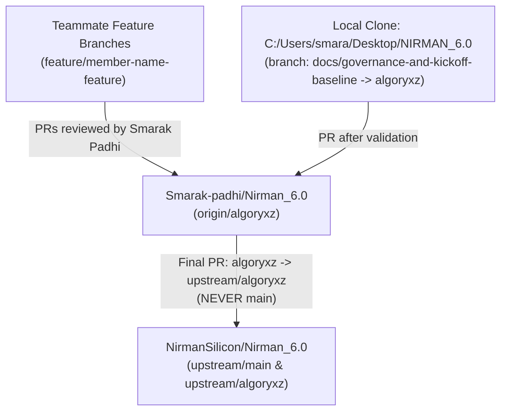
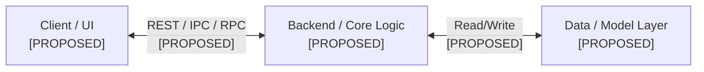

# ARCHITECTURE.md — System Architecture (`algoryxz`)

**Baseline Verification (`VERIFIED`):** As of commit `06c65b4` on `algoryxz`, the branch contains only `.gitignore` and `algoryxz.txt`. No application components exist yet.

---

## 1. Current Repository & Collaboration Topology (`VERIFIED`)

## 2. Target Application Architecture (`PROPOSED` — Placeholder Until ADR-001)
*(Do not treat this placeholder as implemented code.)*

Once ADR-001 is approved in `DECISIONS.md`, update this diagram with exact verified modules, protocols, and file paths.