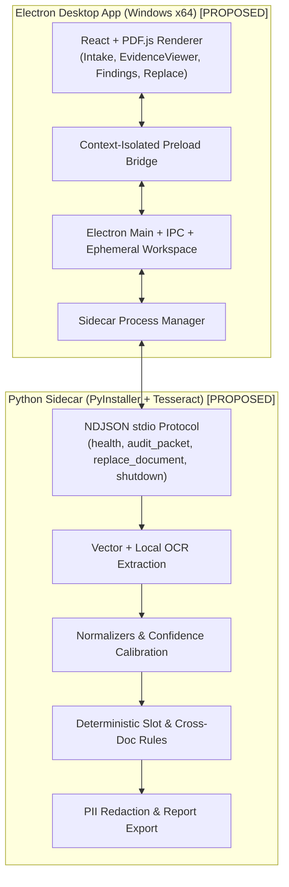

# ARCHITECTURE.md — System Architecture (`algoryxz` — DocuReady for NIRMAN 6.0)

**Baseline (`VERIFIED`):** `algoryxz` (`06c65b4`) contains only `.gitignore` and `algoryxz.txt`. The application topology below is **`PROPOSED`** per ADR-001.

---

## 1. Proposed NIRMAN Application Architecture (`PROPOSED`)

