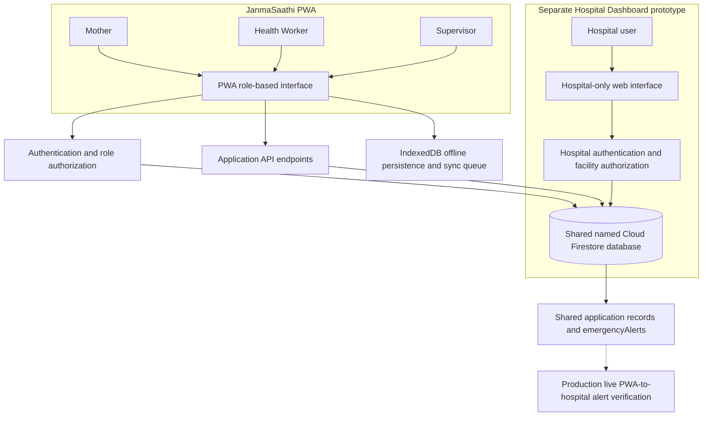

# JanmaSaathi

<p align="center">
  <strong>An Offline-first Maternal Healthcare Monitoring and Emergency Response Platform</strong><br />
  <em>Connecting mothers, community health workers, supervisors, and hospitals through accessible digital care workflows.</em>
</p>

<p align="center">
  
  
  
  
  
  
</p>

> **Project status:** The JanmaSaathi PWA is the primary implemented application. The separate Hospital Dashboard is an interactive prototype. Its production-grade, live PWA-to-hospital alert reception is a future implementation and verification milestone; it is not presented as completed production functionality.

---

## Table of contents

- [1. Project overview](#1-project-overview)
- [2. The problem](#2-the-problem)
- [3. Our approach](#3-our-approach)
- [4. Solution at a glance](#4-solution-at-a-glance)
- [5. JanmaSaathi PWA](#5-janmasaathi-pwa)
  - [User roles](#user-roles)
  - [Core modules and capabilities](#core-modules-and-capabilities)
  - [Offline-first experience](#offline-first-experience)
  - [Emergency alert workflow](#emergency-alert-workflow)
  - [Communication and voice messages](#communication-and-voice-messages)
  - [AI-assisted support](#ai-assisted-support)
  - [Languages and accessibility](#languages-and-accessibility)
- [6. Hospital Dashboard prototype](#6-hospital-dashboard-prototype)
- [7. Architecture and data flow](#7-architecture-and-data-flow)
- [8. Technology stack](#8-technology-stack)
- [9. Firebase environment](#9-firebase-environment)
- [10. Data model overview](#10-data-model-overview)
- [11. Security, privacy, and responsible use](#11-security-privacy-and-responsible-use)
- [12. Local development](#12-local-development)
- [13. Project structure](#13-project-structure)
- [14. Testing and verification](#14-testing-and-verification)
- [15. Current limitations and future roadmap](#15-current-limitations-and-future-roadmap)
- [16. Contributors](#16-contributors)
- [17. Disclaimer](#17-disclaimer)

---

## 1. Project overview

**JanmaSaathi** is a maternal health support and care-coordination platform designed to make pregnancy-related information, routine follow-ups, communication, and emergency escalation more accessible—particularly in communities where connectivity and access to healthcare services may be inconsistent.

The project consists of two related but distinct applications:

1. **JanmaSaathi PWA** — the primary application for Mothers, Health Workers, and Supervisors. It focuses on maternal journeys, assessments, follow-ups, communication, emergency alerts, and offline-capable workflows.
2. **JanmaSaathi Hospital Dashboard** — a separate hospital-facing web dashboard prototype. It establishes the intended hospital-side experience and role-aware workflow. Full production integration for receiving PWA-created alerts in real time remains a future implementation and live-verification milestone.

The applications are designed around a shared Firebase project and a specific named Cloud Firestore database. They are separate frontends and should retain their own role-specific interfaces while following a common data and authorization contract.

## 2. The problem

Maternal care coordination can become difficult when information is distributed across paper records, phone calls, and disconnected systems. Common challenges include:

- Inconsistent access to maternal health information during field visits.
- Delays in recording assessments and following up on warning signs.
- Difficulty maintaining continuity between a mother and her assigned Health Worker.
- Connectivity limitations in rural and low-resource settings.
- Fragmented communication between community-level workers, supervisors, and hospitals.
- Limited visibility into referrals and emergency escalation workflows.

JanmaSaathi aims to support these workflows with one accessible digital platform. It is designed to assist care coordination and record-keeping; it is not a replacement for trained medical professionals or emergency services.

## 3. Our approach

JanmaSaathi follows a role-based, offline-first approach:

- **Mothers** can access pregnancy-related information, record updates, communicate with their assigned Health Worker, and raise an emergency alert.
- **Health Workers** can work with assigned patients, record assessments, coordinate follow-ups, communicate with mothers, and manage referrals.
- **Supervisors** can oversee field operations, Health Worker activity, reports, and referral coordination.
- **Hospitals** have a separate dashboard prototype intended to provide a hospital-side operational view and, in a future phase, receive and manage authorized alerts from the PWA.

The design prioritizes clear workflows, role boundaries, mobile responsiveness, multilingual access, and continued use when the network is unreliable.

## 4. Solution at a glance

| Area | JanmaSaathi PWA | Hospital Dashboard |
|---|---|---|
| Primary audience | Mothers, Health Workers, Supervisors | Hospital users |
| Application type | Progressive Web App | Separate web dashboard prototype |
| Main purpose | Maternal care, field workflows, communication, referrals, emergency alert creation | Hospital-facing operational interface and planned alert intake |
| Offline-first support | Designed with local persistence and queued synchronization | Not positioned as an offline-first PWA |
| Shared backend | Firebase project and named Firestore database | Same Firebase project and named Firestore database |
| Production status | Primary implemented application | Prototype; production alert integration is future work |

## 5. JanmaSaathi PWA

The PWA is the main user-facing product. Its navigation and capabilities are organized around the authenticated user's role.

### User roles

#### Mother

The Mother experience is intended to provide a simple, supportive place to follow a pregnancy journey and stay connected with care support.

Key capabilities include:

- A personalized home experience and pregnancy journey.
- Wellness and pregnancy-care information.
- Maternal updates and health-related information capture.
- Access to the assigned Health Worker through the Connect experience.
- Text communication and actual audio/voice messages.
- Emergency alert creation and access to relevant hospital and helpline information.
- Profile and account settings.

#### Health Worker

The Health Worker experience supports field-level maternal care and patient coordination.

Key capabilities include:

- A patient list based on authorized assignments.
- Access to a mother's profile and available maternal history.
- Maternal assessment and follow-up workflows.
- Referral and care-coordination workflows.
- Communication with assigned mothers through text and actual audio messages.
- Emergency alert and escalation workflows according to role permissions.

#### Supervisor

The Supervisor experience focuses on field oversight and coordination.

Key capabilities include:

- An overview of relevant field activity.
- Health Worker visibility and coordination.
- Reports and monitoring workflows.
- Referral oversight.
- Access to emergency alert workflows according to authorization.

### Core modules and capabilities

The PWA brings together the following functional areas:

| Module / capability | Purpose |
|---|---|
| Role-based access | Separates Mother, Health Worker, and Supervisor workflows and permissions. |
| Maternal journey | Provides a structured view of pregnancy-related progress and updates. |
| Wellness support | Presents pregnancy-care guidance and supportive wellness information. |
| Patient management | Enables Health Workers to access mothers assigned to them. |
| Maternal assessments | Supports structured collection of maternal assessment information. |
| Health updates and follow-ups | Helps maintain continuity of care and document follow-up activity. |
| Referrals | Supports referral and escalation coordination. |
| Reports | Provides access to available records and reporting workflows. |
| Connect and messaging | Supports communication between a mother and her assigned Health Worker. |
| Voice messages | Supports sending and receiving actual audio recordings, not only speech-to-text. |
| Emergency alerts | Allows authorized users to raise and track emergency alerts. |
| Hospital information | Provides relevant hospital and emergency contact information. |
| AI Companion | Provides AI-assisted informational support within the application's intended scope. |
| Multilingual interface | Supports a more accessible experience for users with different language preferences. |

### Offline-first experience

Reliable internet connectivity cannot be assumed in every field setting. The PWA therefore includes an offline-capable approach:

- Application resources are structured for PWA use.
- Local data persistence uses IndexedDB, with the application database identified as `JanmaSaathi_OfflineDB_v1`.
- Supported user actions can be queued locally when connectivity is unavailable.
- Queued changes can synchronize when the network becomes available again.
- The interface is designed to communicate relevant loading, offline, and synchronization states without making connectivity the user's responsibility.

Offline behavior depends on the specific operation and the data already available on the device. Server-authorized operations still require a valid authenticated session and a successful synchronization with the backend.

### Emergency alert workflow

Emergency alert creation is part of the PWA's core workflow. The canonical Firestore collection is:

```text
emergencyAlerts/{alertId}
```

The PWA's alert workflow includes:

- Alert creation by authorized Mother, Health Worker, and Supervisor users.
- Hospital destination and escalation metadata, including fields such as `targetHospitalId`, `targetHospitalName`, `targetFacilityType`, and `escalationTargetHospitalId` where applicable in the current schema.
- Alert source, severity, timestamps, location, and status information according to the alert type and current schema.
- Role-aware alert actions and status handling.
- Offline queueing and synchronization support for supported alert operations.

The `emergencyAlerts` collection is the canonical alert source. The project should not create a second collection or duplicate alert documents to connect the PWA and Hospital Dashboard.

**Important integration status:** The PWA alert-writing and routing code has been audited and locally tested. The separate Hospital Dashboard's production receipt of these alerts has not yet been proven through a live, authenticated end-to-end test. See [Hospital Dashboard prototype](#6-hospital-dashboard-prototype) and [Current limitations and future roadmap](#15-current-limitations-and-future-roadmap).

### Communication and voice messages

JanmaSaathi includes a mother-to-Health Worker communication workflow.

- Text messages are associated with the relevant conversation and participants.
- The conversation is intended to be shared by the assigned Mother and Health Worker, rather than creating separate unrelated threads.
- Voice messaging supports actual audio recording and playback.
- Audio messages are treated as audio files with message metadata and file references; the intended experience is not limited to voice-to-text transcription.
- Message access must follow participant authorization.

The application has an API integration point for voice-message handling (including the existing `/api/voice-messages` route). Actual audio upload, persistence, and playback depend on the configured backend/storage service being available and correctly authorized.

### AI-assisted support

The AI Companion is intended to provide accessible, contextual informational support and help users navigate maternal health topics.

AI-generated information must be treated as assistance, not diagnosis. The system should not present AI output as a substitute for a clinician, emergency service, or qualified Health Worker. Sensitive information should only be sent to an AI service where the application's consent and data-handling rules permit it.

### Languages and accessibility

The localization scope includes:

- English
- Hindi
- Odia

The interface is intended to maintain consistent translations across navigation, forms, labels, validation, and user-facing messages. Language completeness should be checked in the deployed build whenever new interface content is added.

## 6. Hospital Dashboard prototype

The **JanmaSaathi Hospital Dashboard** is a separate hospital-facing web application. It shares the JanmaSaathi backend environment but has its own hospital-oriented interface and authentication boundary.

### Purpose

The dashboard is intended to provide a hospital-side workspace that can support the receiving end of maternal care coordination. It is a prototype demonstrating the planned workflows and interface—not a claim that a complete live hospital alert network is already operational.

### Implemented prototype scope

The current prototype work includes:

- A dedicated Hospital-only login experience.
- A split-screen login layout with hospital branding and a mother-and-child visual direction.
- A hospital-specific authentication flow rather than exposing Mother, Health Worker, or Supervisor login options on the hospital login screen.
- A role-aware hospital application structure.
- Hospital dashboard overview and operational navigation.
- An emergency-alert interface and supporting frontend integration work.
- Shared Firebase project and named Firestore database configuration.
- Facility-aware authorization logic in the application code.
- A Firestore real-time listener implementation in the dashboard code, designed to query alerts by the authenticated hospital's authorized facility identity.
- Loading, empty, error, and permission-denied handling in the alert experience.

### What is not yet complete

The following must remain clearly identified as future implementation or verification work:

- A successful live test in which a real authenticated Mother/Health Worker/Supervisor session creates an alert in the deployed PWA and the correct authenticated hospital session receives it in the deployed Hospital Dashboard.
- Production verification of the hospital user's `hospital_staff` role and matching `facilityId` / `hospitalId` claims or profile data.
- Production verification that the deployed Firestore rules permit the exact facility-filtered listener query while preventing cross-hospital access.
- Final verification of the mapping between the PWA's destination fields (for example, `targetHospitalId`) and the fields used by the Hospital Dashboard query and Firestore rules (for example, `facilityId` or `hospitalId`).
- Any background push-notification workflow. The current approach does not claim that alerts will be pushed to a closed browser or device.

### Hospital Dashboard status statement

> The Hospital Dashboard is currently a functional prototype with a hospital-oriented login, role-aware structure, existing dashboard views, and an implemented alert-receiver approach. Live PWA-to-hospital alert delivery has not yet been verified in production and is planned as a future integration milestone.

## 7. Architecture and data flow

### High-level architecture



The diagram shows the intended shared-data architecture. The dashed connection represents the hospital alert integration that still requires production end-to-end verification; it should not be interpreted as proof of live delivery.

### Shared Firebase environment

The applications must use this exact named Firestore database. They must not silently fall back to a `(default)` database or create a separate database for the Hospital Dashboard.

## 8. Technology stack

The following technologies form the current project stack and implementation direction.

### JanmaSaathi PWA

| Layer | Technology |
|---|---|
| UI framework | React 19 |
| Language | TypeScript |
| Build tooling | Vite 8 |
| Styling | Tailwind CSS v4 |
| Typography | DM Serif Display, DM Sans, and Noto font family where configured |
| Backend and data | Firebase and Cloud Firestore |
| Local persistence | IndexedDB (`JanmaSaathi_OfflineDB_v1`) |
| PWA capabilities | Web app manifest, service-worker/offline application support where configured |
| Application API | Existing server/API routes for supported authentication, session, and voice-message workflows |

### Hospital Dashboard

| Layer | Technology / approach |
|---|---|
| Application | Separate React/TypeScript web dashboard prototype |
| Backend and data | Same Firebase project and named Firestore database as the PWA |
| Data access | Firebase client SDK and facility-filtered Firestore queries where authorized |
| Alert data source | Canonical `emergencyAlerts` collection |
| Authorization | Hospital role and facility identity checks; production rules and claims require live verification |

## 9. Firebase environment

The Firebase project is shared, while each application maintains its own interface and role-specific workflows.


### Important Firebase notes

- Use the named Firestore database ID shown above.
- Keep `emergencyAlerts` as the single canonical alert collection.
- Do not weaken Firestore rules to make a query work.
- Hospital alert queries must be constrained by a verified facility identity.
- Firestore security rules must authorize the query the client actually executes; rules do not act as filters on an unrestricted query.
- The local `firestore.rules` file is not necessarily the same as the currently deployed production rules. Review and verify the deployed rules before relying on them.

## 10. Data model overview

The PWA uses role-specific and workflow-oriented Firestore collections. The collection list below is an architectural overview; the live document schema and security rules remain the source of truth.

| Collection | Intended responsibility |
|---|---|
| `users` | User identity, role, and account-level profile mapping. |
| `mothers` | Mother-facing profile and maternal information. |
| `healthWorkers` | Health Worker profiles and field identity. |
| `supervisors` | Supervisor profiles and role information. |
| `assignments` | Mother-to-Health Worker assignment relationships. |
| `assessments` | Maternal assessment records. |
| `healthUpdates` | Ongoing health and follow-up updates. |
| `referrals` | Referral and escalation coordination records. |
| `reports` | Report metadata and generated or uploaded report records. |
| `messages` | Conversation and messaging data, according to the current messaging schema. |
| `appointments` | Appointment and visit coordination data. |
| `auditLogs` | Auditable application activity where configured. |
| `emergencyAlerts` | Canonical emergency alert records shared by the PWA and planned hospital integration. |

Do not infer that every collection contains every field listed in the UI. Use the current source code, Firestore documents, and security rules when changing the schema.

## 11. Security, privacy, and responsible use

Maternal and pregnancy-related information is sensitive. Security must be enforced at the backend/data layer, not only by hiding interface elements.

Project security principles:

- Authenticate users and enforce role-aware authorization.
- Restrict Health Worker access to assigned mothers and authorized workflows.
- Restrict Hospital Dashboard access to the authenticated hospital's verified facility identity.
- Do not use a default or guessed facility ID when identity resolution fails; fail closed.
- Keep private service-account credentials and private keys out of frontend code and Git history.
- Do not store real patient records, access tokens, passwords, or private keys in the repository.
- Avoid public access to maternal records, messages, audio files, and clinical attachments.
- Preserve auditability for sensitive actions where the application supports it.
- Use synthetic/demo records for screenshots, demonstrations, and automated tests.

### Encryption status

Firebase provides platform-level encryption for supported data services, but this README does **not** claim that the application currently provides end-to-end encryption or a fully deployed AES-256-GCM multi-user key-management system. Application-level encryption should only be described as implemented after key generation, recipient key distribution, recovery, rotation, migration, and cross-application decryption have been designed and tested.

### Medical and AI responsibility

JanmaSaathi is a care-support and coordination tool. It does not diagnose medical conditions, prescribe treatment, or replace professional judgement. Emergency symptoms should be handled through qualified healthcare providers and local emergency services.

## 12. Local development

The commands below are the usual workflow for a Node.js/Vite application. Run them from the root directory of the relevant application repository. If the repository uses a workspace or a different package manager, follow its existing scripts and lockfile.

### Requirements

- Node.js version compatible with the repository's Vite and dependency versions.
- npm (or the package manager used by the repository).
- Access to the configured Firebase project for live-data testing.
- Environment configuration for the relevant application.

### Run the PWA

```bash
npm install
npm run dev
```

### Build and type-check

```bash
npm run build
npx tsc --noEmit
```

### Run the Hospital Dashboard prototype

Use the same basic workflow in the Hospital Dashboard repository:

```bash
npm install
npm run dev
```

Then run the repository's build and type-check scripts before proposing changes. Do not point a local test build at production maternal data unless the test is explicitly authorized and uses the correct access controls.

## 13. Project structure

The exact repository layout may evolve. A typical high-level organization is:

```text
JanmaSaathi/
├── src/
│   ├── components/       # Shared UI components
│   ├── pages/            # Role-specific pages and screens
│   ├── context/          # Authentication and application state
│   ├── services/         # Firebase and application service modules
│   ├── hooks/            # Reusable React hooks
│   ├── utils/            # Shared helpers and validation
│   └── types/            # TypeScript types
├── public/               # PWA assets and static files
├── functions/            # Cloud Functions source, if retained in this repo
├── firestore.rules       # Firestore security rules
├── firestore.indexes.json
├── firebase.json
├── package.json
├── package-lock.json
└── README.md
```

The Hospital Dashboard is maintained as a separate application/repository and should have its own README or deployment configuration where appropriate. This top-level README documents both products and their integration boundary.

## 14. Testing and verification

Testing should cover both code correctness and real user workflows.

### PWA verification areas

- Role-based sign-in and session handling.
- Mother-to-Health Worker assignment visibility.
- Maternal profile and assessment access.
- Text conversation continuity across both participants.
- Actual audio recording, upload, retrieval, and playback.
- Offline data persistence and synchronization when connectivity returns.
- Emergency alert creation and routing metadata.
- Role authorization and Firestore rule behavior.
- Multilingual UI consistency.

### Hospital Dashboard verification areas

- Hospital-only login and role resolution.
- Verified facility identity and fail-closed behavior.
- Facility-filtered emergency alert query.
- Correct loading, empty, error, and permission-denied states.
- Alert rendering and status changes in the prototype.
- Isolation between different hospital facilities.

### Production integration acceptance test (future milestone)

A live alert integration must not be declared complete solely because the frontend builds or local adapter tests pass. The required production test is:

1. Sign in to the deployed PWA as an authorized test user.
2. Keep a separate browser session signed in as a hospital user belonging to the destination facility.
3. Create one controlled alert addressed to that facility.
4. Confirm that exactly one document is written to `emergencyAlerts` in the named Firestore database.
5. Confirm that the authorized Hospital Dashboard displays the alert without a manual page refresh.
6. Confirm that a status update is reflected in the dashboard.
7. Confirm that a different hospital cannot read the alert.

Until this test is completed successfully against the deployed applications and production Firestore rules, live PWA-to-hospital delivery remains **not verified**.

## 15. Current limitations and future roadmap

The roadmap distinguishes implemented product work from capabilities that still require integration, verification, or additional infrastructure.

### Current project status

| Workstream | Status |
|---|---|
| PWA role-based workflows | Implemented in the primary application; continue regression testing. |
| Maternal records and assessment workflows | Implemented in the PWA; governed by current schema and rules. |
| Mother–Health Worker text communication | Implemented; verify against live authorized accounts when releasing. |
| Actual audio messaging | Implemented as an application capability; storage availability and end-to-end playback should be verified in the target environment. |
| Offline-first local persistence and synchronization | Implemented for supported workflows; continue device/network testing. |
| PWA emergency alert creation and routing | Implemented and locally tested. |
| Hospital Dashboard UI and role-aware prototype | Implemented as a separate prototype. |
| Hospital Dashboard live PWA alert reception | **Future implementation / production verification pending.** |
| Background push notifications when the browser is closed | Future capability; not claimed as available. |
| Application-level AES-256-GCM with secure multi-user key management | Security enhancement requiring architecture, implementation, and independent verification; not claimed as complete here. |

### Planned next steps

1. **Complete live hospital alert integration:** Verify the persisted alert schema, destination facility mapping, hospital role/claims, and deployed Firestore rules.
2. **Run authenticated two-session testing:** Prove that a PWA-created alert appears in the correct hospital dashboard without refreshing and that other hospitals are denied access.
3. **Stabilize alert lifecycle handling:** Validate acknowledgement, status updates, escalation, and resolution across the PWA and hospital workflow.
4. **Strengthen attachment and voice-message storage:** Verify encrypted transport, access control, persistence, and authorized playback/download.
5. **Design application-level encryption properly:** If AES-256-GCM is introduced, first implement secure key distribution, recipient access, recovery, revocation, rotation, and backward-compatible migration.
6. **Expand accessibility and field testing:** Continue multilingual reviews, low-connectivity tests, device testing, and usability feedback from intended users.
7. **Consider background notifications later:** Evaluate a production push-notification architecture when the required infrastructure, permissions, and operating budget are available.

## 16. Contributors

Thanks to the contributors helping build and improve JanmaSaathi.

| Contributor | GitHub |
|---|---|
| [@om-prakash2006](https://github.com/om-prakash2006) | Contributor |
| [@dasprakruti1323-blip](https://github.com/dasprakruti1323-blip) | Contributor |
| [@preeti282006](https://github.com/preeti282006) | Contributor |

**Project Lead / Maintainer:** Pratyush Kumar Satapathy

If you contribute, please keep changes focused, avoid committing secrets or real health records, and include the relevant tests or verification notes with your pull request.

## 17. Disclaimer

JanmaSaathi is a software prototype and care-coordination support platform. It is not a medical device, emergency dispatch service, diagnostic system, or substitute for qualified healthcare professionals. Any deployment for real-world clinical use requires appropriate clinical, security, privacy, operational, and regulatory review. Demo data should be used for development and presentations; real patient data must only be handled in an appropriately authorized and protected environment.

---

<p align="center">
  <strong>JanmaSaathi — Supporting safer journeys through connected maternal care.</strong>
</p>
