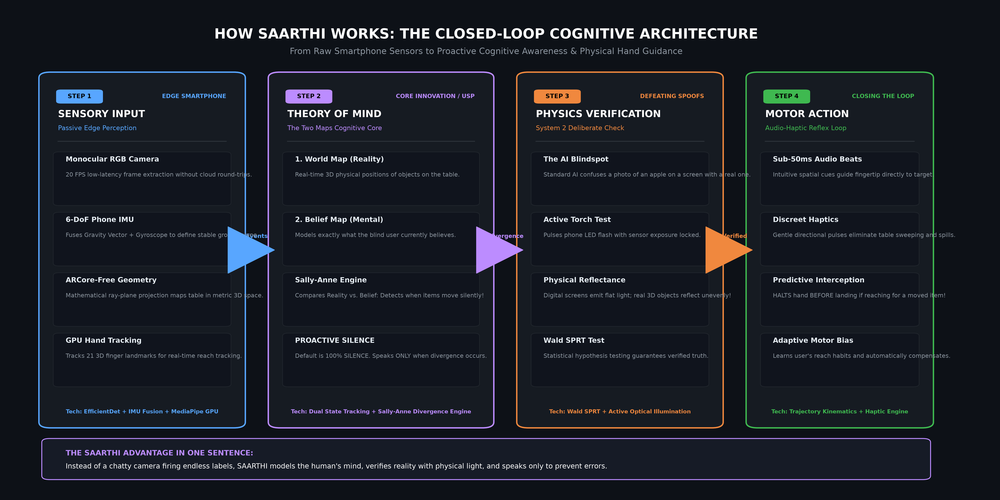

# SAARTHI — Team VectorX (NIRMAN 6.0 · HACKNATION 2026)

> **Personal-space cognitive companion for blind and low-vision individuals.**  
> *Canes navigate the floor. SAARTHI navigates the table.*

---

## The Problem
- **Canes stop at the floor:** White canes detect curbs and stairs, offering zero awareness at desk or dining-table height.
- **Vision AI is a noisy firehose:** Generic detection apps speak 10 labels/second into earphones, drowning hearing (a blind user's primary spatial sense), holding zero memory, and trusting flat screen photos as real objects.

## Core Architecture
1. **Two-Map Sally–Anne Engine (`WorldMap` vs `BeliefMap`) & Proactive Silence:** Tracks physical 3D object positions on the table (via `TYPE_GRAVITY` + `TYPE_GYROSCOPE` + `Camera2` intrinsics, no ARCore) against what the user was told. Speaks **only** when reality diverges from belief.
2. **System 2 Physical Verification (The Torch Test):** Exposure-locked LED flash off/on differential + Wald SPRT bounds separate real 3D objects from 2D screen spoofs.
3. **Closed-Loop Motor Guidance & Memory:** MediaPipe GPU hand tracking with sub-50ms pre-recorded spatial cues, adaptive proprioceptive reach bias, Voice Diary (`"Note: ..."`), and Kaplan–Meier spatial decay.
4. **100% Offline Edge First + Live Laptop Mind View:** Runs offline on a mid-range smartphone (MediaTek Dimensity 700 / Vivo V21e), with an optional USB-tethered 2.5D Cognitive HUD (`Mind View`).

## Repository Status (Initial Progress Push)
Core Android and laptop source modules are being staged progressively ahead of the milestone checkpoints. See:
- [FEATURE_TRACKER.md](FEATURE_TRACKER.md) — Verified feature inventory & hackathon readiness
- [DECISIONS.md](DECISIONS.md) — Binding architectural decisions (D1–D63)
- [docs/FINALS_ELITE_FEATURES.md](docs/FINALS_ELITE_FEATURES.md) — Architecture & demo blueprint
- [docs/PPT_SLIDE_DECK_SPEC.md](docs/PPT_SLIDE_DECK_SPEC.md) — Presentation structure
- [docs/PPT_KNOWLEDGE_BASE.md](docs/PPT_KNOWLEDGE_BASE.md) — Technical dossier & Q&A
