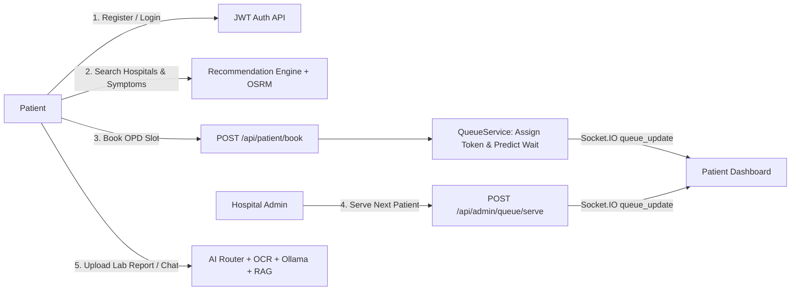
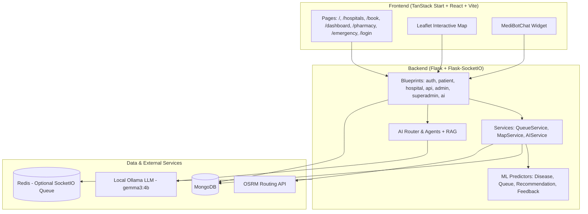

# 🏥 Sanjeevani — Intelligent Healthcare & OPD Management Platform

<p align="center">
  <strong>Making Healthcare Smarter, Faster, and More Accessible.</strong>
</p>

<p align="center">
  An AI-powered healthcare navigation, OPD appointment, live queue management, and clinical assistance platform built for <strong>NIRMAN 6.0 — HACKNATION 2026</strong> by <strong>Team crozbit</strong>.
</p>

---

## 📑 Table of Contents

1. [Hackathon Information](#-hackathon-information)
2. [Problem Statement](#-problem-statement)
3. [Our Solution](#-our-solution)
4. [Key Features](#-key-features)
5. [How the System Works](#-how-the-system-works)
6. [System Architecture](#-system-architecture)
7. [Technology Stack](#-technology-stack)
8. [Project Folder Structure](#-project-folder-structure)
9. [Installation and Setup Instructions](#-installation-and-setup-instructions)
10. [Environment Variables](#-environment-variables)
11. [How to Run the Project](#-how-to-run-the-project)
12. [Demo Mode & Simulated Data](#-demo-mode--simulated-data)
13. [API Overview](#-api-overview)
14. [AI / ML Implementation](#-ai--ml-implementation)
15. [Database Design](#-database-design)
16. [Current Implementation Status](#-current-implementation-status)
17. [Limitations and Future Scope](#-limitations-and-future-scope)
18. [Troubleshooting](#-troubleshooting)
19. [Team Members and Contributions](#-team-members-and-contributions)
20. [Hackathon Submission Information](#-hackathon-submission-information)
21. [License](#-license)

---

## 🏆 Hackathon Information

| Field | Details |
| :--- | :--- |
| **Event** | NIRMAN 6.0 — HACKNATION 2026 |
| **Evaluation Stage** | First Progress Evaluation |
| **Team Name** | `crozbit` |
| **Project Name** | Sanjeevani (backend API internally initialized as HealX) |
| **Repository** | `https://github.com/ayusshs/Nirman_6.0` (branch: `crozbit`) |

---

## 🎯 Problem Statement

Patients and hospitals in traditional outpatient (OPD) ecosystems face persistent operational bottlenecks:

- **Long and unpredictable OPD waiting times** with no real-time visibility into queue progression.
- **Inefficient manual appointment and walk-in queue handling**, leading to overcrowding at hospital counters.
- **Difficulty identifying the right hospital or medical specialist** based on symptoms, distance, and current crowd levels.
- **Fragmented medical records and lab reports** that are hard for patients to interpret before consultations.
- **Limited real-time analytics** for hospital administrators to monitor department load and patient feedback.

---

## 💡 Our Solution

**Sanjeevani** unifies hospital discovery, OPD appointment booking, live Socket.IO queue tracking, AI-assisted symptom/report guidance, and hospital admin analytics into a single web platform:

- **Patients** can discover hospitals on an interactive map, get AI-ranked hospital recommendations, book OPD slots, track their live queue position and estimated wait time, upload lab reports/prescriptions for OCR + AI summarization, and chat with an AI healthcare assistant.
- **Hospital Admins & Superadmins** can manage appointments, advance live department queues, view AI-generated operational insights and patient clinical summaries, analyze patient feedback sentiment, and export appointment data as CSV.

> [!NOTE]
> AI-generated guidance and report summaries are informational only and do not replace professional medical diagnosis.

---

## ✨ Key Features

### Implemented in Repository
- **Hospital Discovery & Geospatial Routing**: Browse and search hospitals (`/hospitals`, `/hospitals/$id`), view specialties and doctor slots, and compute driving routes/ETAs using OSRM (`MapService`) and Leaflet maps.
- **Smart OPD Appointment Booking (`/book`)**: Multi-step booking flow with hospital, department/specialty, doctor, and slot selection, backed by `POST /api/patient/book` and walk-in support (`POST /api/walkin_book`).
- **Live OPD Queue Management**: Atomic queue numbering (`QueueService`), live wait-time calculation (`GET /api/patient/active-appointment`, `GET /api/hospital/<hospital_id>/queue`), and real-time `queue_update` broadcasts via Flask-SocketIO.
- **JWT Authentication & Role Separation (`/login`)**: Patient signup/login (`POST /api/auth/signup`, `POST /api/auth/login`) and Admin/Superadmin authentication using `flask-bcrypt` and `PyJWT`.
- **AI Multi-Agent Assistant (`MediBotChat`)**: Intent-routing AI assistant (`POST /api/chat`, `POST /api/ai/chat`) with specialized agents for appointments, queue status, hospital recommendations, report summaries, and medical Q&A, backed by local Ollama (`gemma3:4b`), RAG over `backend/knowledge/`, and rule-based offline fallbacks.
- **Medical Report Upload & AI Summary**: Upload PDFs or images (`POST /api/patient/upload_report`) parsed via `pdfplumber` / `easyocr` and summarized via Ollama.
- **Admin & Superadmin Operations**: Queue advancement (`POST /api/admin/queue/serve`), appointment status management, AI patient clinical briefs, feedback sentiment/topic analytics, CSV export, and platform-wide superadmin management.

### UI-Simulated / In-Progress Modules
- **Digital Pharmacy (`/pharmacy`)**: Interactive medicine catalog, cart drawer, and multi-step checkout UI using client-side data (`medicineData.ts`).
- **SOS Emergency Center (`/emergency`)**: First-aid guides and simulated ambulance dispatch telemetry using mock hospital coordinates.
- **Patient Portal Enhancements (`/dashboard`)**: Digital health card / ABHA-style ID display and vitals UI alongside live backend appointments and reports.

---

## 🔄 How the System Works



1. **Authentication**: A patient signs up or logs in at `/login`; the backend issues a 24-hour HS256 JWT stored in `localStorage`.
2. **Hospital Discovery**: The frontend calls `GET /api/hospital/` (auto-seeding sample Bhubaneswar hospitals via `POST /api/hospital/seed` if the database is empty) and `GET /api/hospital/search` for symptom-to-department + ML-ranked recommendations.
3. **Appointment & Queue Assignment**: Booking an appointment atomically increments `total_in_queue` in MongoDB, estimates wait time using `QueuePredictor` (XGBoost or rule-based fallback), and emits a Socket.IO `queue_update` event.
4. **Live Tracking & Admin Serving**: As admins advance the queue via `POST /api/admin/queue/serve` or update appointment statuses, the patient's `people_ahead` and `wait_time_predicted` recalculate live.
5. **AI & Report Assistance**: Patient chat messages pass through `AIRouter` (intent detection + conversation memory + RAG context + Ollama/fallback); uploaded reports pass through `ReportAnalyzer` (`pdfplumber` / `easyocr` + Ollama).

---

## 🏗️ System Architecture



- **Frontend (`frontend/`)**: Built with **TanStack Start**, **TanStack Router**, **TanStack Query**, **React 19**, **TypeScript**, and **Tailwind CSS v4**. Communicates with the Flask backend at `http://localhost:5000/api` (`frontend/src/lib/api.ts`).
- **Backend (`backend/`)**: Modular **Flask** application factory (`create_app()` in `backend/app/__init__.py`) registering 7 blueprints (`/api/auth`, `/api/patient`, `/api/hospital`, `/api`, `/api/admin`, `/api/superadmin`, `/api/ai`) with **Flask-SocketIO** for real-time queue events.
- **Database**: **MongoDB** via `pymongo` (`patients`, `hospitals`, `appointments`, `queue`, `queue_history`, `reports`, `admins`, `feedback` collections). **Redis** is optional for Socket.IO message queuing and falls back to an in-memory queue if unavailable.
- **AI/ML Layer**: Combines 4 `.joblib` scikit-learn/XGBoost/LightGBM models in `trained_models/`, a JSON-backed RAG store (`backend/trained_models/rag_index.json`), `pdfplumber`/`easyocr` document extraction, and local **Ollama** inference with deterministic fallbacks.

---

## 🛠️ Technology Stack

| Layer | Technologies Verified in Repository |
| :--- | :--- |
| **Frontend Framework** | React 19, TypeScript, TanStack Start, TanStack Router, TanStack Query, Vite 8 |
| **UI & Visualization** | Tailwind CSS v4, Radix UI, Lucide React, Recharts, Leaflet |
| **Forms & Validation** | React Hook Form, Zod |
| **Backend Framework** | Python, Flask, Flask-SocketIO, Flask-CORS, Flask-Bcrypt, PyJWT, Gunicorn |
| **Database & Messaging** | MongoDB (`pymongo`), Redis (optional Socket.IO message queue) |
| **AI / LLM & RAG** | Ollama (`gemma3:4b` default), `sentence-transformers`, `anthropic` (listed in `requirements.txt`), custom JSON RAG store |
| **ML & Data** | `scikit-learn`, `xgboost`, `lightgbm`, `pandas`, `numpy`, `joblib` |
| **OCR & PDF Parsing** | `easyocr`, `pdfplumber` |
| **Geospatial Routing** | OSRM (`router.project-osrm.org`), Leaflet |

---

## 📂 Project Folder Structure

```text
Nirman_6.0/
├── crozbit.txt                        # Hackathon & team identifier
├── trained_models/                    # Pre-trained ML model artifacts (.joblib)
│   ├── disease_risk_model.joblib
│   ├── feedback_sentiment_model.joblib
│   ├── queue_model.joblib
│   └── recommendation_model.joblib
│
├── backend/
│   ├── Procfile                       # Gunicorn process definition
│   ├── requirements.txt               # Python dependencies
│   ├── run.py                         # Flask-SocketIO entry point (port 5000)
│   ├── seed_superadmin.py             # Script to seed default superadmin
│   ├── test_*.py                      # Backend API, AI, routing, and signup test scripts
│   ├── knowledge/                     # RAG knowledge base (.txt files: faqs, hospitals, policies)
│   ├── ml/                            # Training scripts for the 4 ML models
│   ├── ml_models/train.py             # Additional ML training script
│   ├── trained_models/rag_index.json  # Pre-indexed RAG knowledge file
│   └── app/
│       ├── __init__.py                # Flask app factory, MongoDB, SocketIO, blueprints
│       ├── config.py                  # Environment configuration loader
│       ├── ai/                        # AI router, agents, Ollama client, RAG, ML predictors
│       ├── models/                    # MongoDB data access classes
│       ├── routes/                    # Flask blueprints (auth, patient, hospital, api, admin, superadmin, ai)
│       ├── services/                  # QueueService, MapService, AIService
│       └── utils/                     # Synthetic dataset generator
│
└── frontend/
    ├── package.json                   # Node dependencies & Vite scripts
    ├── vite.config.ts
    ├── tsconfig.json
    ├── public/                        # Static assets (logo.png, hero-video.mp4)
    └── src/
        ├── router.tsx                 # TanStack Router setup
        ├── routeTree.gen.ts           # Generated route tree
        ├── components/                # UI components (HospitalMap, MediBotChat, CameraCapture, etc.)
        ├── hooks/                     # Custom React hooks
        ├── lib/                       # API client (api.ts), mockData.ts, medicineData.ts, utils
        └── routes/                    # File-based routes (/, /login, /dashboard, /book, /hospitals, /pharmacy, /emergency, /about)
```

---

## ⚙️ Installation and Setup Instructions

### Prerequisites
- **Python 3.10+**
- **Node.js 18+** and **npm**
- **MongoDB** (local MongoDB Community Server or a MongoDB connection URI)
- **Ollama** (optional, for local LLM chat & report summarization; backend falls back to rule-based responses if Ollama is not running)
- **Redis** (optional; backend falls back to simple in-memory Socket.IO queue if unavailable)

### 1. Clone the Repository
```powershell
git clone https://github.com/ayusshs/Nirman_6.0.git
cd Nirman_6.0
```

### 2. Backend Setup (Windows PowerShell)
```powershell
cd backend
python -m venv .venv
.\.venv\Scripts\Activate.ps1
pip install -r requirements.txt
```

Create a `.env` file inside `backend/` (see [Environment Variables](#-environment-variables)).

*(Optional)* Seed the default superadmin account:
```powershell
python seed_superadmin.py
```

### 3. Frontend Setup (Windows PowerShell)
Open a new terminal in the repository root:
```powershell
cd frontend
npm install
```

---

## 🔐 Environment Variables

Create `backend/.env` using placeholders — **never commit `.env` or real credentials**:

```env
# Flask & JWT Security
SECRET_KEY=your_random_secret_key_here

# Database (Required for backend persistence)
MONGO_URI=mongodb://localhost:27017/sanjeevani

# Optional Redis for SocketIO message queue
REDIS_URL=redis://localhost:6379/0

# Optional Local LLM (Ollama)
LLM_PROVIDER=ollama
OLLAMA_BASE_URL=http://localhost:11434
OLLAMA_MODEL=gemma3:4b
DEFAULT_MODEL=gemma3:4b

# Optional External Keys (referenced in Config)
ANTHROPIC_API_KEY=your_anthropic_api_key_if_used
TWILIO_SID=your_twilio_sid_if_used
TWILIO_AUTH=your_twilio_auth_token_if_used
TWILIO_PHONE=your_twilio_phone_if_used
```

> [!IMPORTANT]
> `frontend/src/lib/api.ts` currently sets `API_BASE_URL = "http://localhost:5000/api"`. Ensure the backend runs on port `5000` during local development.

---

## ▶️ How to Run the Project

### Start the Backend Server
```powershell
cd backend
.\.venv\Scripts\Activate.ps1
python run.py
```
The Flask-SocketIO server starts on `http://localhost:5000`. Visiting `http://localhost:5000/` returns `{"message": "Welcome to HealX API"}`.

### Start the Frontend Development Server
```powershell
cd frontend
npm run dev
```
The Vite / TanStack Start dev server starts on `http://localhost:5173` (or the port printed in your terminal).

### Optional: Start Ollama for Local LLM Features
```powershell
ollama pull gemma3:4b
ollama serve
```

---

## 🧪 Demo Mode & Simulated Data

- **Auth-Gated Frontend Routes**: In `frontend/src/routes/__root.tsx`, navigating to `/dashboard` or `/book` checks `isLoggedIn()` (`localStorage.getItem("token")`) and redirects unauthenticated users to `/login`.
- **Automatic Hospital Seeding**: When `fetchHospitals()` receives an empty list from `GET /api/hospital/`, it automatically calls `POST /api/hospital/seed` to populate 3 sample Bhubaneswar hospitals (`SUM Hospital`, `AIIMS Bhubaneswar`, `Capital Hospital`).
- **Mock UI Enrichment (`frontend/src/lib/mockData.ts`)**: Backend hospital records are merged with mock bed counts, review counts, distances, and placeholder images for UI display.
- **Simulated Modules**:
  - `/pharmacy` uses static medicine catalog data (`medicineData.ts`) and a simulated checkout flow (e.g., coupon `SANJEEVANI30`, 3D card UI).
  - `/emergency` displays simulated ambulance tracking telemetry and static first-aid instructions.
  - `ReportAnalyzer` falls back to sample lab/MRI text if `EasyOCR` fails to initialize on an image upload.

---

## 📡 API Overview

All routes are mounted under `/api` (see `backend/app/__init__.py` and `backend/app/routes/`):

| Prefix | Method & Endpoint | Description |
| :--- | :--- | :--- |
| `/` | `GET /` | Health/welcome check |
| **Auth** (`/api/auth`) | `POST /api/auth/signup` | Register a new patient account |
| | `POST /api/auth/login` | Authenticate patient or admin/superadmin, returns JWT |
| **Patient** (`/api/patient`) | `GET /api/patient/profile` | Fetch patient profile, appointments, reports (JWT required) |
| | `PUT /api/patient/profile` | Update patient profile fields (JWT required) |
| | `GET /api/patient/active-appointment` | Fetch active appointment with live queue wait recalculation |
| | `GET /api/patient/appointments` | List all patient appointments |
| | `GET /api/patient/appointment/<booking_id>` | Get single appointment + embedded hospital info |
| | `POST /api/patient/book` | Book OPD appointment & assign queue token |
| | `POST /api/patient/upload_report` | Upload PDF/image report for OCR + AI summary |
| | `GET /api/patient/reports` | List uploaded patient reports |
| **Hospital** (`/api/hospital`) | `POST /api/hospital/seed` | Seed sample hospitals into MongoDB |
| | `GET /api/hospital/` | List all hospitals |
| | `GET /api/hospital/search` | Search & AI-rank hospitals by disease, state, query, `lat`/`lng` |
| | `GET /api/hospital/<hospital_id>` | Get hospital details and doctors |
| | `PUT /api/hospital/<hospital_id>` | Update hospital details |
| | `GET /api/hospital/<hospital_id>/route` | Get OSRM driving route from `start_lat`, `start_lng` |
| | `GET /api/hospital/<hospital_id>/queue` | Get live queue metrics per department |
| **Public / AI** (`/api`, `/api/ai`) | `POST /api/walkin_book` | Book a walk-in appointment without patient login |
| | `POST /api/chat` | Send message to `AIRouter` (with rule-based fallback) |
| | `POST /api/ai/chat` | Direct `AIRouter` chat endpoint |
| | `GET /api/reverse-geocode` | Reverse geocode `lat`, `lng` via `MapService` |
| **Admin** (`/api/admin`) | `GET /api/admin/appointments` | List appointments (filterable by `status`, `hospital_id`) |
| | `PUT /api/admin/appointments/<booking_id>/status` | Update appointment status & log queue history |
| | `POST /api/admin/queue/serve` | Increment `current_serving` & broadcast Socket.IO update |
| | `GET /api/admin/analytics` | Hospital appointment counts, queues, & AI insights |
| | `GET /api/admin/patient/<patient_id>/ai_summary` | Generate doctor brief via DiseasePredictor + Ollama |
| | `GET /api/admin/feedback_analytics` | Analyze review sentiment & common topics |
| | `GET /api/admin/export` | Export appointments as CSV |
| **Superadmin** (`/api/superadmin`) | `GET /api/superadmin/dashboard`, `/analytics` | Platform-wide counts (Superadmin JWT required) |
| | `GET / POST /api/superadmin/hospitals`, `PUT .../<id>` | Manage hospitals |
| | `GET / POST /api/superadmin/admins` | Manage hospital admins |

---

## 🤖 AI / ML Implementation

1. **Trained ML Models (`trained_models/*.joblib`, trained via `backend/ml/train_*.py` on synthetic/generated data)**:
   - **Disease Risk Predictor (`disease_risk_model.joblib`)**: `RandomForestClassifier` predicting `Low Risk`, `Medium Risk`, or `High Risk` from `age`, `bmi`, `sys_bp`, `sugar`, `smoking`, `exercise`, and `family_history` (falls back to a weighted rule score if the bundle is absent).
   - **Queue Wait-Time Predictor (`queue_model.joblib`)**: `XGBRegressor` predicting wait time in minutes using `people_ahead`, encoded `department`, `hour`, `weekday`, `holiday`, `emergency`, and `doctor_average_time` (falls back to `people_ahead * doctor_avg_time`).
   - **Hospital Recommendation Engine (`recommendation_model.joblib`)**: `LGBMRegressor` ranking hospitals using `distance`, `rating`, `queue_length`, `crowd_level`, `doctor_experience`, and `availability`.
   - **Feedback Sentiment Analyzer (`feedback_sentiment_model.joblib`)**: `TfidfVectorizer` + `MultinomialNB` pipeline classifying reviews as `positive`, `neutral`, or `negative`, paired with keyword-based topic extraction (`Waiting Time`, `Doctor Care`, `Billing`, `Cleanliness`, `General`).
2. **Multi-Agent AI Router & RAG (`backend/app/ai/`)**:
   - `AIRouter` classifies user messages into `appointment`, `queue_status`, `hospital_recommendation`, `report_summary`, `wallet_query`, or `medical_question` and dispatches to specialized agents.
   - `ContextBuilder` injects patient database context and RAG snippets from `backend/trained_models/rag_index.json` (built from `backend/knowledge/`).
   - `OllamaClient` queries `http://localhost:11434/api/chat` (`gemma3:4b` default) and gracefully degrades to keyword-based responses when Ollama is offline.
3. **Report Analyzer (`backend/app/ai/report_analyzer.py`)**:
   - Extracts text from PDFs (`pdfplumber`) and images (`easyocr`) and sends up to 1,200 characters to Ollama for a patient-friendly summary.

---

## 🗄️ Database Design

The backend uses **MongoDB** (`pymongo`) with the following collections:

| Collection | Key Fields & Purpose |
| :--- | :--- |
| `patients` | `patient_id` (`PAT-...`), `name`, `email`, `password_hash`, `gender`, `dob`, `bloodGroup`, `phone`, `emergency_contact`, `address`, `aadhar`, `insurance`, `tss_points`, `medicines`, `reports`, `bills` |
| `hospitals` | `hospital_id` (`HOSP-...`), `name`, `logo`, `address`, `location` (`city`, `state`, `lat`, `lng`), `workingHours`, `phone`, `email`, `specialties`, `departments`, `crowd_level`, `rating`, `doctors` |
| `appointments` | `booking_id` (`HLX-YYYYMMDD-DEPT-...`), `patient_id`, `hospital_id`, `doctor_id`, `department`, `slot_time`, `queue_number`, `status`, `wait_time_predicted`, `type`, `symptoms`, `paymentMode`, `paymentStatus`, `booked_at` |
| `queue` | `hospital_id`, `department`, `current_serving`, `total_in_queue`, `avg_time_per_patient`, `last_updated` (updated atomically via `find_one_and_update`) |
| `queue_history` | Event log of queue actions (`joined`, `served`, `completed`, `cancelled`, `no-show`) |
| `reports` | `patient_id`, `filename`, `extracted_text`, `ai_summary`, `uploaded_at` |
| `admins` | `admin_id` (`ADM-...`), `name`, `email`, `password_hash`, `role` (`admin` / `superadmin`), `hospitalId` |
| `feedback` | Patient review texts and departments used by `/api/admin/feedback_analytics` |

---

## 📊 Current Implementation Status

| Module | Status | Notes |
| :--- | :--- | :--- |
| Patient Auth (Signup / Login / JWT) | ✅ Implemented | `auth.py`, `login.tsx` |
| Hospital Listing, Seeding & Search | ✅ Implemented | `hospital.py`, `HospitalMap.tsx`, `mockData.ts` UI merge |
| OPD Booking & Live Queue Tracking | ✅ Implemented | `patient.py`, `QueueService`, Socket.IO |
| Admin Queue Serving, Analytics & CSV Export | ✅ Implemented | `admin.py`, `superadmin.py` |
| AI Router, ML Models & Report Analyzer | ✅ Implemented | Uses local Ollama + `.joblib` models trained on synthetic data; includes fallbacks |
| Digital Pharmacy (`/pharmacy`) | 🟡 Simulated UI | Static catalog (`medicineData.ts`) & simulated checkout |
| SOS Emergency & Ambulance Tracking (`/emergency`) | 🟡 Simulated UI | Static first-aid & mock ambulance telemetry |
| Android / Amazfit Bip 5 Wearable Integration | 🔵 Planned | Not yet present in repository |

---

## 🔭 Limitations and Future Scope

### Current Limitations
- ML models (`disease_risk_model`, `recommendation_model`, `feedback_sentiment_model`, `queue_model`) are trained on synthetic/generated datasets rather than live hospital clinical datasets.
- Frontend `API_BASE_URL` is hardcoded to `http://localhost:5000/api` in `frontend/src/lib/api.ts`.
- Admin and Superadmin routes have dedicated backend APIs, while the frontend primarily focuses on the patient portal.
- Pharmacy and Emergency modules currently operate on simulated frontend data.

### Future Scope
- Persist pharmacy orders and live ambulance dispatch telemetry in MongoDB.
- Build dedicated frontend portals for Hospital Admins and Superadmins.
- Add Android companion app integration for wearable queue/vibration alerts (e.g., Amazfit Bip 5).
- Retrain ML models on anonymized real-world OPD datasets and add automated CI tests.

---

## 🛠️ Troubleshooting

- **MongoDB Connection Error (`Error connecting to MongoDB`)**:
  - Verify MongoDB is running locally or your `MONGO_URI` in `backend/.env` is valid and reachable.
- **Redis Warning (`Could not connect to Redis, falling back to simple queue`)**:
  - Non-fatal. Flask-SocketIO automatically falls back to an in-memory queue for single-instance local development.
- **Ollama Offline Fallback**:
  - If Ollama is not running on `http://localhost:11434`, `OllamaClient` automatically returns rule-based fallback responses so `/api/chat` and `/api/patient/upload_report` do not crash.
- **Redirected to `/login` when opening `/dashboard` or `/book`**:
  - Expected behavior (`__root.tsx`). Sign up a new patient account at `/login` first to obtain a JWT token.
- **Empty Hospital List**:
  - Ensure the Flask backend is running on port `5000`; `fetchHospitals()` will automatically trigger `POST /api/hospital/seed` on first load.

---

## 👥 Team Members and Contributions

**Team:** `crozbit` (NIRMAN 6.0 — HACKNATION 2026)

| Member Name | Role / Focus Area | Contributions |
| :--- | :--- | :--- |
| `[Member 1 Name]` | Frontend & UI/UX | TanStack Start / React frontend, Leaflet maps, OPD booking & portal UI |
| `[Member 2 Name]` | Backend & Database | Flask APIs, MongoDB models, JWT auth, Socket.IO queue service |
| `[Member 3 Name]` | AI / ML & RAG | Multi-agent AI router, Ollama integration, `.joblib` ML models, OCR report analyzer |
| `[Member 4 Name]` | Testing & Integration | End-to-end testing, deployment config, documentation |

*(Replace placeholders above with actual team member names and verified role splits before final submission.)*

---

## 📝 Hackathon Submission Information

- **Hackathon**: NIRMAN 6.0 — HACKNATION 2026
- **Submission Milestone**: First Progress Evaluation
- **Team**: `crozbit`
- **Active Branch**: `crozbit`

---

## 📄 License

No `LICENSE` file is currently present in this repository. Add an appropriate open-source license (e.g., MIT) if required for final submission.
