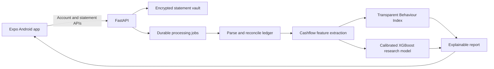

# UQUAL — Explainable Financial Statement Scoring

UQUAL is an Android and Python research demonstrator for turning a bank statement into an explainable cashflow profile. A user creates an account, uploads a supported CSV, XLSX or text PDF statement with consent, reviews transaction categories and sees a descriptive Behaviour Index alongside a separately labelled machine-learning research index. The app also offers coaching, what-if analysis and a shareable financial passport. This branch contains only the scoring product.

## Architecture



## What the scores mean

The **Behaviour Index** is a published, weighted cashflow rubric. The **Research Model Index** is `100 × (1 − calibrated probability of the simulated training target)`. They are different measures. Neither is a bureau score, lending approval or validated real-world default estimate.

The research model was trained on 10,584 borrower profiles derived from a generated dataset of 20,000 profiles and 11,083,461 simulated transactions. Ten monotonic cashflow features feed an XGBoost classifier. Validation selected the model; separate data calibrated it; the final temporal test was untouched. Test ROC AUC was **0.9181**, PR AUC **0.5749** and Brier score **0.0805** on **3,132 simulated profiles**. A different-seed cohort from the *same simulator* reached ROC AUC **0.9227**. These are simulator measurements, not evidence of accuracy on real Indian repayment outcomes. See [measured figures and limitations](evidence/README.md).

## Run the backend

Use Python 3.11:

```sh
python3.11 -m venv .venv
. .venv/bin/activate
python -m pip install -r requirements.lock.txt
python -m pip install -e . --no-deps
PYTHONPATH=src python scripts/run_mobile_backend.py --host 127.0.0.1 --port 8000
```

The first launch creates `data/private/` locally for account storage and a developer API key. It is ignored by Git. For a phone on the same Wi-Fi, start the backend with `--host <your-laptop-LAN-IP>` and enter `http://<your-laptop-LAN-IP>:8000` under **Server settings** on the app's login screen. Local HTTP is for the controlled demo only. For internet use, configure TLS and a stable deployed host.

## Run the Android app

```sh
cd mobile
npm ci
npx expo start
```

The Android emulator uses `http://10.0.2.2:8000` by default. A physical phone must use the laptop's LAN address in Server settings. For a release APK, install Android Studio/SDK and JDK 17, then run `npm run build:android`. See [mobile setup](mobile/README.md).

## Verify

```sh
python -m pytest -q tests
cd mobile && npm run typecheck && npm run lint
```

The included model files are small, trained research artifacts so the demo can run without downloading the multi-million-row dataset. The dataset and personal account files are not committed. Training configuration and code are included for inspection; reproducing full training requires generating the dataset with `uqual generate-synthetic` and following the provenance in the model card.

## Limits

Statement parsing supports selected formats and may require category review. Scanned PDF OCR, email recovery, live bank aggregation, real repayment-outcome validation and a production lending policy are not implemented. Do not use the research index for credit decisions.
