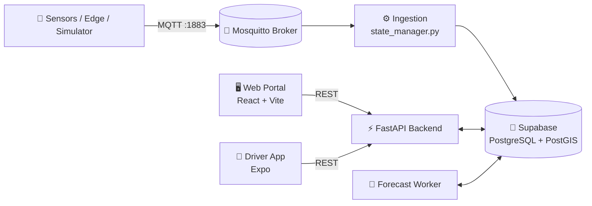

<div align="center">

# 🅿️ ParkSMART

### Real-time smart parking for modern cities

**From sensor to street to smartphone: live IoT telemetry, a geospatial backend, an operations portal and a driver app, all in one platform.**

<br/>


[Overview](#-overview) · [Architecture](#-architecture) · [Features](#-roles--features) · [Structure](#-repository-structure) · [Quick Start](#-quick-start) · [Tech Stack](#-tech-stack)

</div>

---

## ✨ Overview

**ParkSMART** is a full-stack smart parking ecosystem that turns raw sensor signals into decisions for cities, operators, and drivers.

| | Layer | What it does |
|---|---|---|
| 📡 | **IoT / Edge Telemetry** | Live zone occupancy streamed over MQTT |
| ⚡ | **FastAPI Backend** | REST API + MQTT ingestion on Supabase (PostgreSQL + PostGIS) |
| 🖥️ | **Web Operations Portal** | Role-based dashboards for admins, field staff and traders |
| 📱 | **Driver Mobile App** | Expo / React Native app for finding parking |

---

## 🏗️ Architecture



**Data flow in one line:** devices publish → Mosquitto routes → ingestion commits live zone telemetry straight to PostgreSQL/Supabase → the API serves it to the web portal and driver app.

---

## 👥 Roles & Features

### 🏛️ Municipal Admin
- City-wide view of parking zones and live status
- Analytics and trends powered by **Recharts**
- Map-based oversight with **MapLibre GL**

### 🧑‍🔧 Field Operator
- Operational, on-the-ground view of zones
- Live occupancy to support day-to-day enforcement and maintenance

### 🏪 Business / Trader Operator
- Role-specific view tailored to business and trader needs

### 🚗 Driver (Mobile)
- Cross-platform **Expo / React Native** app (`parksmart-driver`)
- Live parking availability on the go

---

## 📁 Repository Structure

```text
ParkSMART/
├── backend/            # FastAPI REST API, Alembic migrations, MQTT ingestion
│   └── app/modules/ingestion/state_manager.py   # commits live zone telemetry to Supabase
├── web/                # React 18 + TypeScript + Vite operations portal
├── driver-app/         # Expo / React Native driver app (parksmart-driver)
├── infra/
│   └── mosquitto/      # Eclipse Mosquitto config (mosquitto.conf, port 1883)
├── edge/               # Edge processing components
├── forecast_worker/    # Forecasting worker service
├── simulator/          # Telemetry / traffic simulator
├── scripts/            # Utility & demo seeding scripts
├── docs/               # Documentation & architecture specs
├── docker-compose.yml  # Containerized orchestration
├── Makefile            # Task shortcuts
└── .env.example        # Template for the shared root .env
```

---

## 🚀 Quick Start

> **Prerequisites:** Python 3, Node.js + npm, and optionally Docker for a local MQTT broker.

### 0️⃣ Configure the environment
Place the shared `.env` file in the **project root**. Use `.env.example` as your template.

### 1️⃣ Backend: FastAPI

```powershell
cd backend
pip install -e ".[dev]"
pip install asyncpg psycopg2-binary
uvicorn app.main:app --reload --host 0.0.0.0 --port 8000
```

API runs at **http://localhost:8000** (interactive docs at `/docs`).

### 2️⃣ Web Portal

```powershell
cd web
npm install
npm run dev
```

### 3️⃣ Driver App

```powershell
cd driver-app
npm install
npx expo start --tunnel
```

Scan the QR code with **Expo Go** to run it on your phone.

### 4️⃣ Local MQTT Broker *(optional)*

```powershell
docker run --rm -it -p 1883:1883 -v "${PWD}\infra\mosquitto\mosquitto.conf:/mosquitto/config/mosquitto.conf" eclipse-mosquitto
```

---

## 🧰 Tech Stack

| Area | Technologies |
|---|---|
| **Backend** | Python · FastAPI · Uvicorn · SQLAlchemy · AsyncPG · Psycopg2 · Alembic |
| **Database** | Supabase (PostgreSQL + PostGIS) |
| **Messaging / IoT** | MQTT · Eclipse Mosquitto (port `1883`) |
| **Web Frontend** | React 18 · TypeScript · Vite · MapLibre GL · Recharts · React Router |
| **Mobile** | React Native · Expo |
| **Tooling** | Docker Compose · Makefile |

---

## 📚 Documentation

Architecture specs and deeper guides live in [`/docs`](./docs).

---

<div align="center">

**Built to make every parking spot count. 🅿️**

</div>
