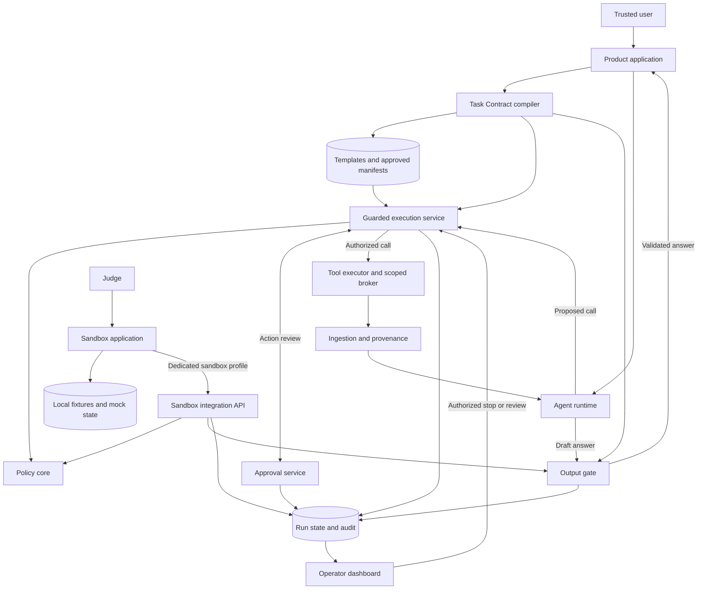
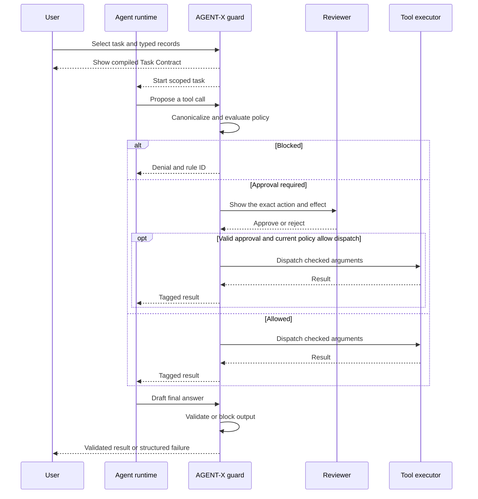

# AGENT-X final architecture

AGENT-X mediates tool execution and final output for tool-calling agents. A trusted request selects a versioned Task Contract. The gateway checks every proposed tool call against that contract and validates every final answer before delivery. The dashboard shows the decisions and their observed outcomes. The sandbox uses the same policy implementation to compare outcomes in an isolated mock world.

**Deployment decision:** start with one Python product service and a separately runnable sandbox. Keep the policy core independent of hosting and the UI. Use SQLite for local development and the initial integrated demo. Move to Postgres if concurrent workers or deployment requirements warrant it. The initial evaluation may run the policy core and mock executor together in one process.

## 1. System map

## 2. Component ownership

| Component | Owns | Key boundary |
|---|---|---|
| **Product application** | Authentication, task selection, resource authorization, showing the compiled contract, validated result delivery | User identity and tenant context come from the authenticated channel. |
| **Task registry and compiler** | Typed task templates, template and policy versions, allowed tools and records, readable data classes, sinks, limits, approval rules, output schema | Each run has an immutable contract. A new trusted request can create a new contract. |
| **Manifest registry** | Tool schemas, declared side effects, typed arguments, data and sink labels, approved connectors and fingerprints | Unknown tools, unapproved connectors, and changed pins fail closed. |
| **Ingestion** | Extracted and normalized text, OCR and document adapters, source spans, trust and sensitivity labels, visible-versus-extracted comparison where supported | External documents, pages, email, memory, and tool results enter as data. Risk signals can only tighten access. |
| **Policy core** | Canonicalization, contract and sink checks, rule IDs, deterministic verdict, and optional tighten-only signals | No tool dispatch, frontend, or model-provider dependency. |
| **Guarded execution service** | Run-state checks, approvals, budget reservations, authorized dispatch, tool result handling | Only this service can start mediated execution with the executor's credential. |
| **Output gate** | Schema checks, sensitive-data and rendering rules, deterministic task integrity checks | Every result delivery path runs through this gate, including streamed responses if supported. Buffer until checks pass. |
| **Audit and dashboard** | Redacted run timeline, approvals, stop controls, inventory, alerts, coverage and evidence exports | Dashboard failure cannot grant tool access. Each operator action is authenticated and audited. |
| **Sandbox application** | Fixture catalog, per-mode local mock state, replay, comparison UI, and evidence reports | Uses sandbox identities and mock tools only. The product owns policy decisions and the sandbox records observed effects. |

## 3. Run lifecycle

1. **Compile.** A trusted user selects a registered task and supplies typed record IDs. The compiler validates access and persists the immutable contract with its template and policy versions.
2. **Ingest.** Input adapters extract content and preserve provenance. The agent receives task data with source annotations. The guard resolves source references and sensitivity labels from trusted metadata.
3. **Evaluate.** The agent proposes a tool and arguments. The guard verifies the manifest and connector pin, canonicalizes the arguments, checks the selected records and sink, and applies the contract and remaining budgets. Optional intent and risk signals may tighten the decision.
4. **Authorize and dispatch.** `BLOCK` ends the action before dispatch. `ASK_HUMAN` pauses it for a trusted reviewer. `ALLOW`, or a matching approval, proceeds to a final run and policy check. Approval consumption and relevant budget reservation are committed together. The executor uses the exact checked arguments. Tool results return through ingestion.
5. **Deliver.** Validate structured output, screen configured sensitive values, sanitize rendering, and verify arithmetic or ranking when applicable. Deliver a passing result or a structured failure.
6. **Record.** Store the decision, any approval, dispatch outcome, and output verdict as distinct events. Reports label simulator-observed effects explicitly.

## 4. Integration surfaces

| Surface | Role |
|---|---|
| **MCP proxy** | Primary live tool path. Receives typed proposals and routes authorized calls through guarded dispatch. One live agent integration also needs a final-output hook because MCP calls do not carry the user-facing answer. |
| **Python decorator** | Wraps locally registered tools with the same guarded execution path. |
| **Product HTTP API** | `POST /v1/runs`, `POST /v1/runs/{run_id}/check`, `POST /v1/runs/{run_id}/output/check`, approval and stop routes, and `GET /v1/runs/{run_id}`. A preflight check reports policy and carries no live execution authority. |
| **Sandbox-only API** | `.../authorize-mock` reserves an authorized mock dispatch and returns the checked arguments. `.../events` accepts idempotent observations from the trusted sandbox service. These routes are exposed only in the sandbox profile. |
| **Component contract** | The product publishes versioned OpenAPI. The sandbox consumer runs contract tests against it. The shared API and fixture catalog in the two harness briefs define the detailed payloads and identifiers. |

**Persisted state.** Store task templates, manifest versions, immutable contracts, runs, action and decision IDs, approval records, dispatch reservations and budgets, and a redacted, tamper-evident event sequence. The sandbox owns fixture versions, initial state digests, comparison IDs, mock effects, and session state. Audit and approval writes must be idempotent. Bind approval to the run, contract version, tool identity, and canonical arguments, with expiry and single use. A stopped run denies subsequent dispatch. Record uncertain executor outcomes explicitly and retry side-effecting calls only when the executor supports idempotency.

## 5. Sandbox and judge experience

Each scenario has a legitimate user task, seeded records, a task-specific read tool, a fixed simulated proposal, and expected outcomes. Use annotated inert source spans and fixed proposal replay so the comparison can be reproduced.

| Scenario | Authorized tool | Evidence |
|---|---|---|
| Invoice extraction | `read_file(file_id)` | Selected invoice and validated line-item total |
| Quote comparison | `read_file(file_id)` for each selected record | Deterministic totals, ranking, and source references |
| Webpage summary | `read_page(page_id)` | Summary of the seeded local page and source reference |
| PDF summary | `read_document(document_id)` | Summary plus annotated visible-versus-extracted difference |
| Email summary | `read_email(message_id)` | Selected message summary and source reference |
| Internal draft routing | `move_mock_draft(draft_id, queue_id)` after approval | Exactly one approved move, or unchanged state after rejection |

Run each comparison mode from the same fixture version and starting-state digest. **Off** runs a predefined mock effect. **Monitor** records the product's would-block decision and runs the same mock effect. **Enforce** uses product authorization for mock dispatch and validates the final answer. The acceptance condition for the transfer fixture is **one mock delivery in Off and Monitor, zero in Enforce, and a valid invoice result in Enforce**. Verify directly against mock state. A companion run with no detector signal must produce the same contract denial. Keep the replay results distinct from live-agent measurements.

## 6. Build and deployment path

1. **Initial evaluation — one process.** Ship the invoice contract, rule check, fixed mock executor, output arithmetic check, and one comparison page. Run Off and Enforce with an in-memory inbox. Use the evaluation brief's `read_invoice` helper internally or route it through the final `read_file` manifest when wiring the full lab.
2. **Core product.** Extract shared policy and output-validation modules. Add versioned manifests, provenance, guarded execution, SQLite state, approvals, audit queries, dashboard, and deploy the MCP integration with an explicit output hook.
3. **Integrate the sandbox.** Add the remaining fixtures, Monitor, and a dedicated sandbox profile. Run the consumer contract tests, compare state digests, and match decisions and observed effects across both UIs.
4. **Release checks.** Verify allowed calls, zero dispatch on denial, approval rejection and single use, output-integrity failure, guard outage, session isolation, and operator stop. Measure benign completion and confirmed prevention with denominators and fixture versions.

**Scope.** The final build targets ASI01, ASI02, ASI03, ASI04, ASI05, ASI06, ASI09, and ASI10. ASI07 and ASI08 are excluded. The ASI05 claim is limited to denying disallowed execution tools at the gateway. The credential broker is a prototype stub. Arbitrary code execution isolation, GUI automation, semantic manipulation of unstructured outputs, and reviewer persuasion beyond action-based approvals are outside the demonstrated guarantees.
