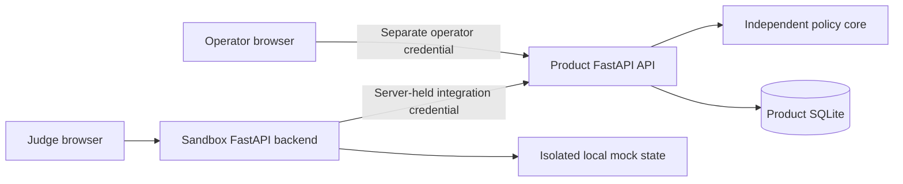

# Architecture

Architectural reference: [AGENT-X final architecture](AGENT-X-FINAL-ARCHITECTURE.md), supplied by the user and reproduced in the root README. This document describes the scaffold's current implementation and its operational limits. The scaffold follows the reference's one Python product service, separately runnable sandbox, independent policy core, and SQLite-first deployment decision.

## Ownership and runtime boundaries

The product owns immutable task scope, typed policy decisions, approval state, reservations, output validation, and run evidence. The sandbox owns fixtures, deterministic proposals, mock effects, session isolation, and comparison display. `agent_x_shared` contains wire types and a versioned fixture catalog; there is no second policy implementation in the simulator.

Browsers call their own backend. The sandbox never receives production tool credentials. Product and sandbox use the same Python distribution but separate processes and containers. Compose puts them on a dedicated bridge network and binds published ports to loopback. Mock tools have no network operations; the bridge itself does not impose an outbound firewall. Containers have a read-only root filesystem, a writable temporary filesystem, no Linux capabilities, and run as UID 10001. Only the product has a persistent data volume. Health checks gate sandbox startup on product readiness.

## Deterministic policy slice

Templates validate strict typed parameters, resolve local resources, and snapshot the template, policy version, resources, allowed tools, mock manifest fingerprints, approval requirement, and budgets. Source content and the optional fixture risk signal never modify the contract.

Evaluation checks run status, reviewed mock-manifest membership, typed arguments, allowed tool, selected resource, and exact queue destination. Checks are not execution grants. The sandbox-only authorization gate rechecks status, manifest pins, and the canonical stored action before reserving a dispatch. Production exposes no execution endpoint yet.

Decisions use stable rule identifiers such as `MANIFEST_UNAPPROVED`, `ARGUMENTS_INVALID`, `TOOL_OUT_OF_SCOPE`, `RESOURCE_OUT_OF_SCOPE`, `DESTINATION_OUT_OF_SCOPE`, `APPROVAL_REQUIRED`, `RUN_STOPPED`, and `BUDGET_EXCEEDED`. Product decisions are identical in Monitor and Enforce; mode changes only how the simulator applies mock effects.

## State and retries

SQLite migration `001_initial.sql` stores one JSON aggregate per run. `BEGIN IMMEDIATE` serializes approval consumption, cumulative call/argument-byte accounting, and dispatch reservations. Contracts have no update route. Checks replay by action ID plus full request digest; changed inputs return 409. Output and observation IDs also reject conflicting reuse. Approval resolution is role-checked, expires after five minutes, and consumes once with the reservation. The mock executor deduplicates effects by reservation ID.

The run aggregate design favors a small working scaffold. Move to normalized tables, explicit repository interfaces, stronger immutable-storage guarantees, and further migrations as the product grows. SQLite connections close after every operation, including Windows tests.

Integration timeout, malformed response, unknown verdict, or missing reservation stops the affected Enforce path before its pending effect. Earlier completed effects remain recorded. There are no retries around live external effects because no live executor exists. A future side-effecting executor must support idempotency or report an uncertain outcome explicitly; a check response must never be reused as a production execution grant.

Simulator comparisons are session-cookie-owned and process-local, limited to 200 comparisons. Reset creates a new comparison and three new product runs from the same seed; it does not mutate old audit evidence. One sandbox worker is supported. Durable sandbox storage and cleanup policies remain future work.

## Output and evidence

Seed-backed invoice checks use Decimal amounts and decimal strings in the wire format. USD fixture totals use two decimal places and round-half-even. Quote ranking is ascending total, then stable record ID; mixed currency is rejected. The scaffold checks seeded expected structured answers exactly, including source references. It does not evaluate arbitrary unstructured answers or perform real OCR/PDF extraction.

Audit events separate evaluations, dispatch reservations, and sandbox-reported observations. Events have server UTC timestamps, sequence numbers, previous-event hashes, and canonical payload hashes. The chain detects isolated edits; it is not externally anchored and cannot prevent a database writer from rewriting the whole chain. The current key-based redaction helper is not a complete sensitive-data classifier. Do not use real sensitive data in this scaffold.

Reports correlate product run IDs, fixture/policy versions, initial-state digests, decisions, output verdicts, mock deliveries, and queue moves. Scoring counts prevention only for an explicit Enforce block whose corresponding effect did not occur. Off and Monitor are labelled dummy results; failures are visible and are not counted as successful Enforce completion.
