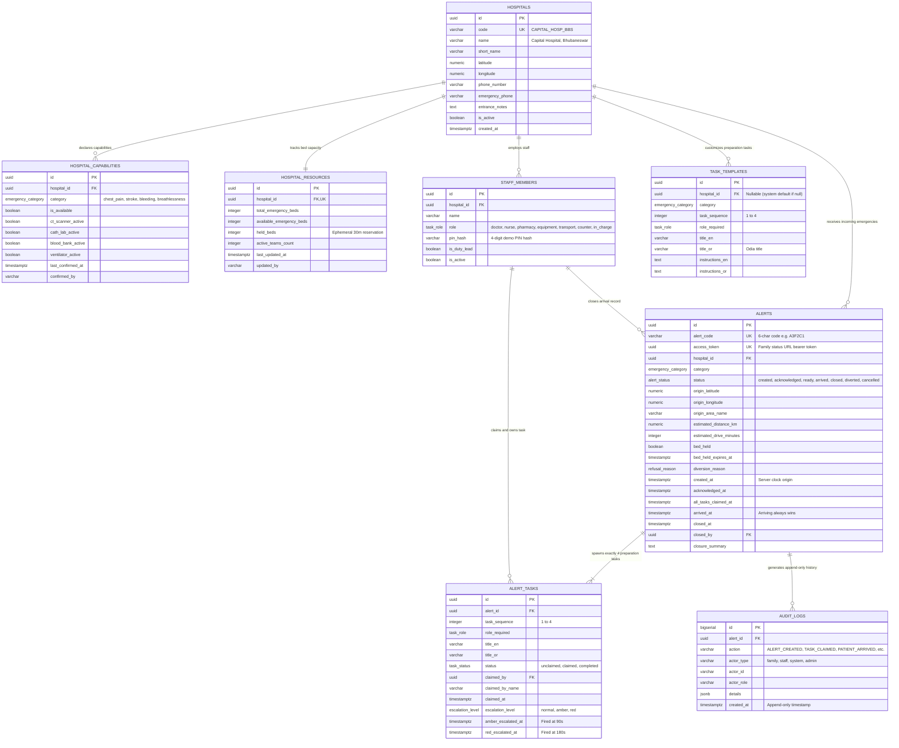

# GoldenHour: Database Relationship Diagram (ERD)

This document specifies the database relationships, foreign keys, cardinality, and constraints for **GoldenHour** (`NIRMAN 2026`).

---

## 1. Mermaid Entity-Relationship Diagram

---

## 2. Table Relationships & Cardinality

| Parent Table | Child Table | Cardinality | Cascade Action | Reason |
| :--- | :--- | :--- | :--- | :--- |
| `hospitals` | `hospital_capabilities` | 1 to Many | `ON DELETE CASCADE` | Hospital manages up to 4 red-flag emergency capability records. |
| `hospitals` | `hospital_resources` | 1 to 1 | `ON DELETE CASCADE` | Exactly one capacity record per hospital (beds, held beds, teams). |
| `hospitals` | `staff_members` | 1 to Many | `ON DELETE CASCADE` | Staff members belong strictly to their hospital account. |
| `hospitals` | `task_templates` | 1 to Many | `ON DELETE CASCADE` | Optional customized task descriptions (4 tasks per category). |
| `hospitals` | `alerts` | 1 to Many | `ON DELETE RESTRICT` | Alerts are matched and dispatched to a selected hospital. |
| `alerts` | `alert_tasks` | 1 to 4 | `ON DELETE CASCADE` | Each alert automatically spawns exactly 4 preparation tasks. |
| `alerts` | `audit_logs` | 1 to Many | `ON DELETE CASCADE` | All actions, state changes, and escalations generate immutable audit entries. |
| `staff_members` | `alert_tasks` | 1 to Many | `ON DELETE SET NULL` | When a task is claimed, staff member's ID and name are recorded. |

---

## 3. Strict Database Constraints

1. **Exactly 4 Tasks per Alert**:
   * `alert_tasks` enforces `CHECK (task_sequence BETWEEN 1 AND 4)`.
   * Composite unique key `UNIQUE (alert_id, task_sequence)` prevents duplicates or omissions.
2. **Short 6-Character Alert ID**:
   * `alerts.alert_code` is a 6-character unique constraint (`UNIQUE NOT NULL`).
   * Collision-free generator (`generate_unique_alert_code()`) selects characters from a safe alphabet omitting ambiguous letters (`I`, `O`, `0`, `1`).
3. **Multi-Tenant Hospital Isolation**:
   * Row-Level Security (RLS) ensures staff from Hospital A cannot view or manipulate Hospital B's incoming alerts or escalations.
4. **Append-Only Audit Guarantee**:
   * PostgreSQL trigger `prevent_audit_log_modification()` strictly blocks any `UPDATE` or `DELETE` on `audit_logs`.
