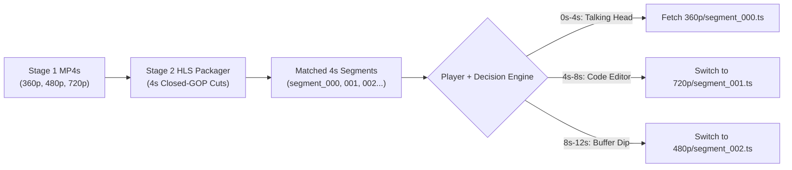
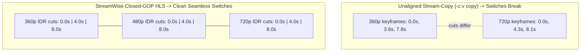
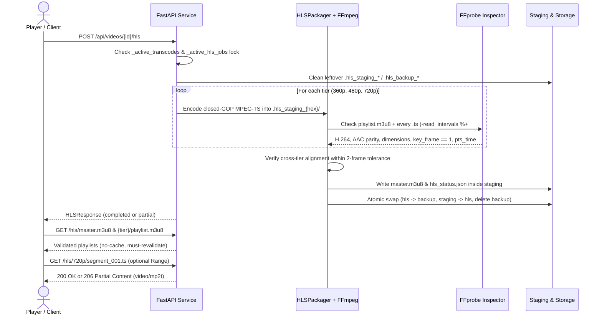
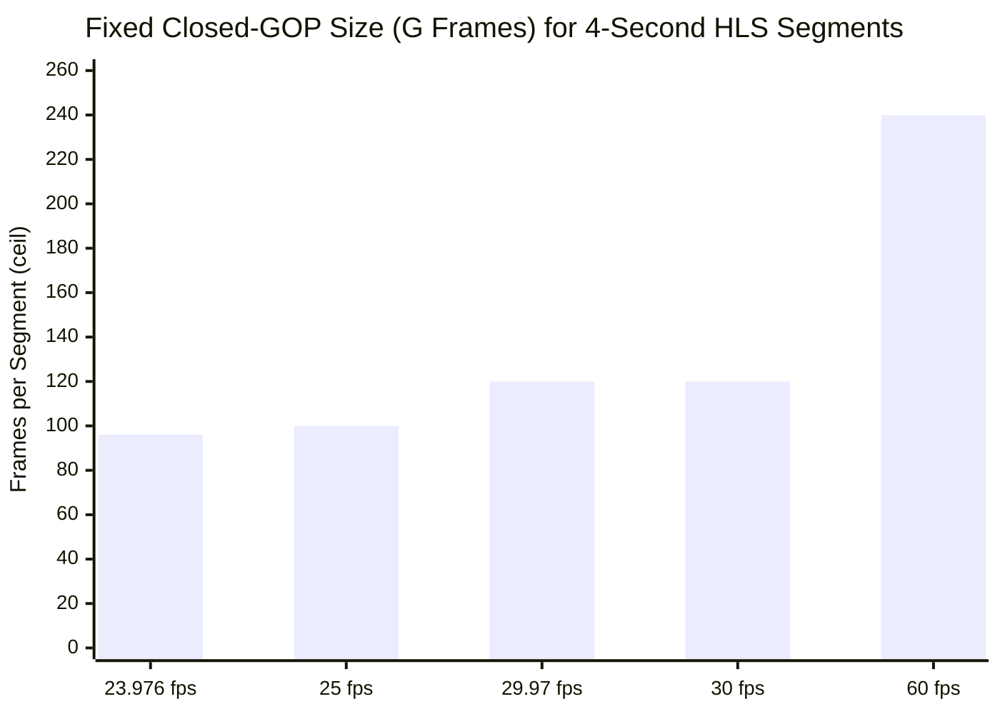
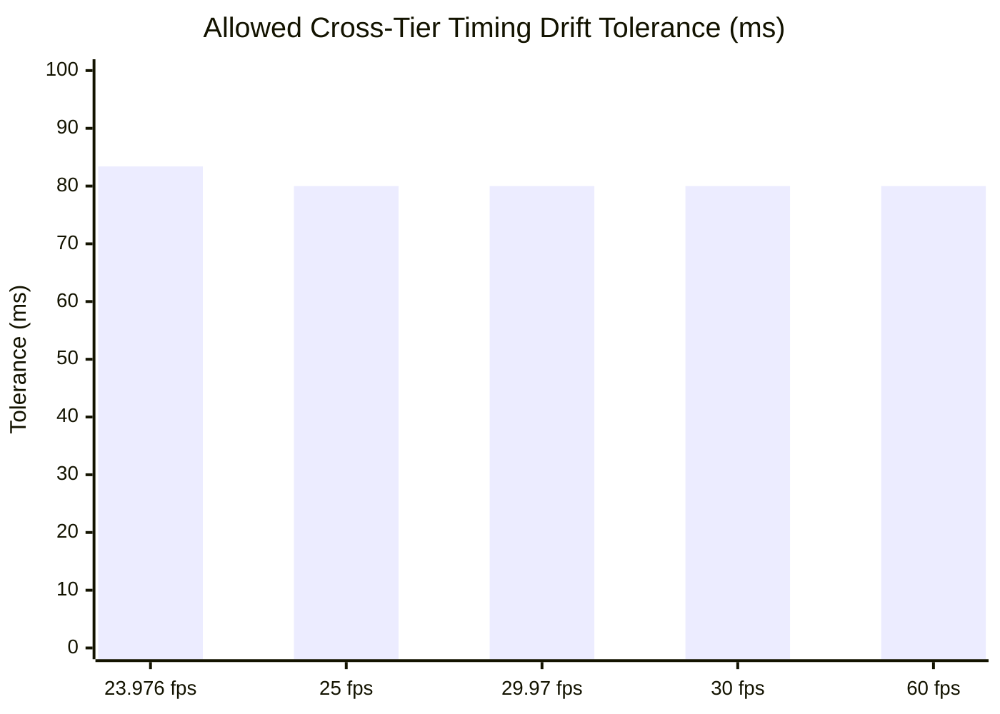
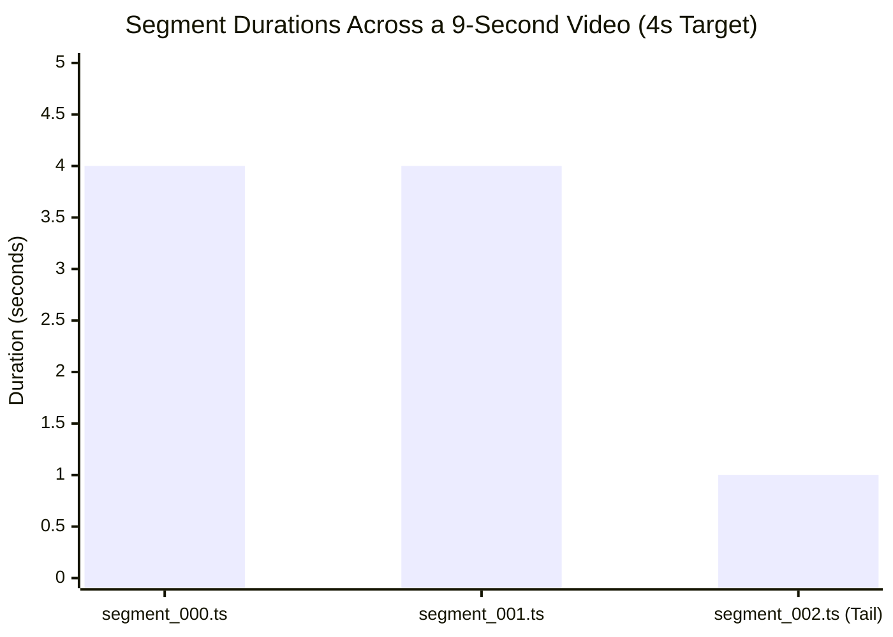
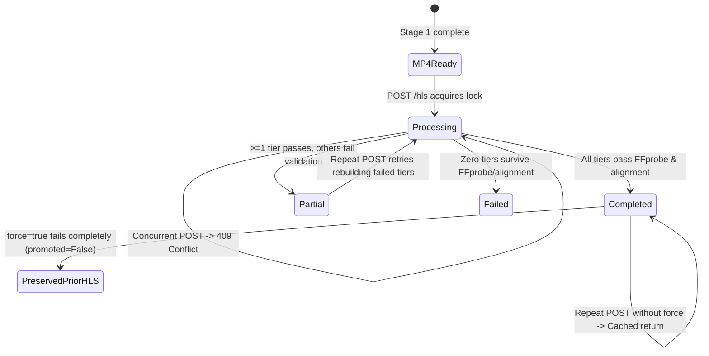
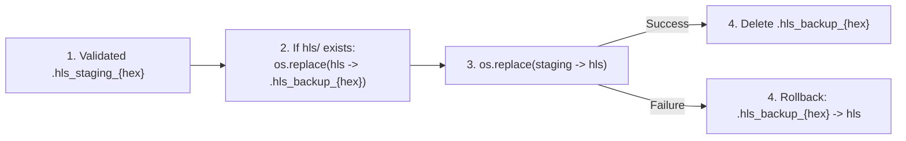
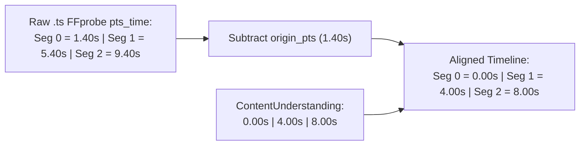
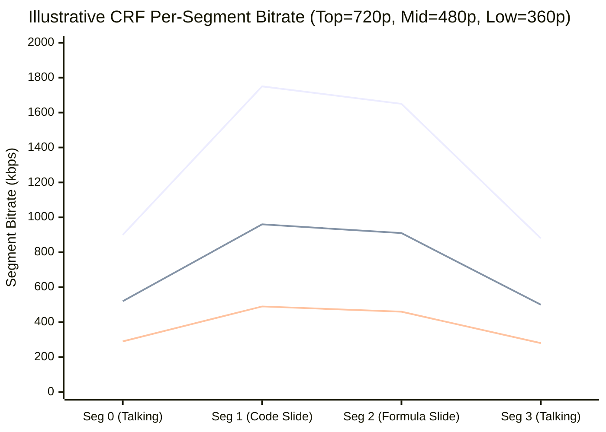

# StreamWise — How HLS Segmentation Works (Simple & Visual Guide)

This guide explains how **StreamWise** slices multi-resolution videos into synchronized HLS chunks using plain English, visual charts, exact math formulas, subtle gotchas, and Q&A answers.

> **TL;DR (In 15 Seconds)**  
> Stage 1 creates standalone `360p`, `480p`, and `720p` MP4s. Stage 2 re-encodes them into **$4\text{-second}$ `.ts` segments** whose keyframes lock onto the exact same timestamps across every quality tier. FFprobe inspects **every single `.ts` file** for keyframe alignment before StreamWise atomically swaps the new `hls/` folder live.

---

## 1. The Big Idea: Why Segment Video Into Aligned Chunks?

If a browser downloaded one giant `720p` MP4, switching to `360p` when WiFi slows down—or jumping to `720p` when dense code appears—would force it to restart from byte zero.

Instead, **HLS** chops every resolution into matched **$4\text{-second}$ `.ts` segments**, each starting on an **independent keyframe (IDR)** at the exact same timestamp:

---

## 2. Why Not Just Cut Without Re-Encoding? (Aligned vs Unaligned)

A common shortcut (`ffmpeg -c:v copy`) tries to split existing MP4s without re-encoding. Because MP4 tiers choose scene-cut keyframes independently, cuts drift across resolutions and switches break:

### Stage 1 vs Stage 2 At a Glance

| Stage | Endpoint | Input | Output | Why Keep Them Separate? |
| :--- | :--- | :--- | :--- | :--- |
| **1. MP4 Transcode** | `POST /api/videos/{video_id}/transcode` | Raw upload (`source.*`) | `360p`/`480p`/`720p/video.mp4` | Aspect ratio scaling, no upscaling, mod-2 pixel dimensions |
| **2. HLS Package** | `POST /api/videos/{video_id}/hls` | Stage 1 MP4s | `hls/master.m3u8` + `segment_%03d.ts` | Re-run HLS (`?force=true`) or tune duration without touching uploads/MP4s |

---

## 3. End-to-End Request, Validation & Playback Flow

Here is everything that happens across components when you package and play a video:

---

## 4. Visual Math Charts & Formulas

### Chart 1: GOP Size Across Frame Rates ($G$)

Because movies and screen captures often use NTSC fractional rates ($23.976$ or $29.97\text{ fps}$), [`hls_config.py`](file:///c:/Users/HP/OneDrive/Documents/GitHub/StreamWise/backend/app/modules/video_processing/hls_config.py#L35-L44) calculates fixed GOP length $G$ using **ceiling** rounding (`math.ceil`) for $T_{\text{seg}} = 4\text{s}$:

$$
G = \max\left(1,\, \left\lceil \text{fps} \times T_{\text{seg}} \right\rceil\right)
$$

**Why ceiling ($\lceil \cdot \rceil$) instead of floor ($\lfloor \cdot \rfloor$)?**  
At $29.97\text{ fps}$, $29.97 \times 4 = 119.88$. Floor (`119` frames $= 3.97\text{s}$) would force a GOP keyframe **1 frame early**, right before `-force_key_frames` triggers at `4.00s`—creating double keyframes. Ceiling (`120` frames) lets `-force_key_frames` cut cleanly on schedule.

---

### Chart 2: Cross-Rendition Alignment Tolerance ($\tau$)

Every tier is verified against `renditions[0]` for matching segment counts, `#EXTINF` durations ($D_k$), and actual FFprobe start timestamps ($\text{PTS}_k$) within a 2-frame tolerance (minimum $80\text{ ms}$):

$$
\tau = \max\left(0.08,\, \frac{2.0}{\max(\text{fps}_{\min},\, 1.0)}\right)\text{ seconds}
$$

$$
\left|D_{c,k} - D_{r,k}\right| \le \tau \quad \text{and} \quad \left|\text{PTS}_{c,k} - \text{PTS}_{r,k}\right| \le \tau
$$

Notice how the **`80 ms` minimum floor** kicks in for all rates $\ge 25\text{ fps}$, while lower cinema rates (`23.976 fps`) smoothly expand to `83.4 ms` (exact 2-frame window).

---

### Chart 3: Worked Example — Chunk Sizes for a `9.0s` Lecture Clip

Suppose a $9.0\text{-second}$ video is segmented with `HLS_SEGMENT_DURATION_SECONDS = 4`:

| Segment File | Raw TS `pts_time` | Normalized Timeline | Keyframe Check | Notes |
| :--- | :--- | :--- | :--- | :--- |
| `segment_000.ts` | `~1.400s` | `0.000s -> 4.000s` | `key_frame == 1` | Full $4\text{s}$ chunk |
| `segment_001.ts` | `~5.400s` | `4.000s -> 8.000s` | `key_frame == 1` | Full $4\text{s}$ chunk |
| `segment_002.ts` | `~9.400s` | `8.000s -> 9.000s` | `key_frame == 1` | Shorter tail chunk ($\lceil 9/4 \rceil = 3$ total) |

### Master Playlist & Drift Formulas

Before promotion, [`hls_packager.py`](file:///c:/Users/HP/OneDrive/Documents/GitHub/StreamWise/backend/app/modules/video_processing/hls_packager.py#L368-L380) checks total playlist duration drift and computes `master.m3u8` bitrates:

- **Duration Drift Limit:** $\left|\sum_k D_k - D_{\text{MP4}}\right| \le \max(0.5,\, 0.15 \times D_{\text{MP4}})$
- **Average Bandwidth (`AVERAGE-BANDWIDTH`):** $B_{\text{avg}} = \max\left(1,\, \operatorname{round}\left(\frac{8 \sum_k S_k}{\max(\sum_k D_k,\, 0.1)}\right)\right)$
- **Peak Bandwidth (`BANDWIDTH`):** $B_{\text{peak}} = \max\left(B_{\text{avg}},\, \max_k \operatorname{round}\left(\frac{8 S_k}{\max(D_k,\, 0.1)}\right)\right)$

---

## 5. HLS Job States, Failure Handling & Rollback

Instead of deleting live streams before validating new ones, StreamWise stages work inside `.hls_staging_{hex}/` and tracks explicit states in [`service.py`](file:///c:/Users/HP/OneDrive/Documents/GitHub/StreamWise/backend/app/modules/video_processing/service.py#L332-L437):

### Windows-Safe Atomic Folder Swap

---

## 6. FFmpeg Flags & Two-Level Validation Cheat Sheet

`build_hls_ffmpeg_command` runs FFmpeg cleanly (`shell=False`, `stdin=DEVNULL`, timeout `180s` per tier):

| FFmpeg Flag | What It Does in Plain English |
| :--- | :--- |
| `-c:v libx264 -preset fast -crf {26\|24\|22}` | Encodes `360p` (CRF 26), `480p` (CRF 24), `720p` (CRF 22) in H.264 |
| `-g {G} -keyint_min {G}` | Locks min/max GOP length to `ceil(fps * 4)` frames |
| `-sc_threshold 0` & `scenecut=0` | Stops scene cuts from inserting extra unaligned keyframes |
| `-x264-params open-gop=0` | Prevents frames inside a `.ts` file from referencing adjacent `.ts` chunks |
| `-force_key_frames "expr:gte(t,n_forced*4)"` | Forces exact IDR cuts at `0s, 4s, 8s...` across every tier |
| `-map 0:a:0 -c:a aac -b:a {96k\|128k}` or `-an` | Matches audio (`96k` on `360p`, `128k` on `480p/720p`) or strips cleanly if silent |
| `-hls_flags independent_segments` | Writes `#EXT-X-INDEPENDENT-SEGMENTS` and ensures self-contained TS segments |

Every staged `.ts` file is then checked by `parse_media_playlist` + `_probe_segment` (`ffprobe -read_intervals %+#5`) for: non-zero bytes, H.264 video, exact resolution, AAC audio parity, and **`first_frame.key_frame == 1`**.

---

## 7. Things We Might Have Missed (Visualized Gotchas)

### Gotcha 1: MPEG-TS Timestamps Start Near `1.4s`, NOT `0.0s`!

FFmpeg's MPEG-TS muxer shifts initial `pts_time` upward (commonly around `~1.4s`) to leave PCR/B-frame DTS buffer room. [`content_decision_adapter.py`](file:///c:/Users/HP/OneDrive/Documents/GitHub/StreamWise/backend/app/modules/integration/content_decision_adapter.py#L195-L212) subtracts `origin_pts` so HLS matches ContentUnderstanding's `0.0s` clock:

### Gotcha 2: Per-Segment Bitrate Fluctuates Under CRF (Illustrative Chart)

`master.m3u8` stores **static peak/average** bitrates per tier, whereas `ContentDecisionAdapter` calculates **per-segment** bitrates from actual `.ts` byte sizes (`(file_size * 8) / (duration * 1000)`). Because CRF `26/24/22` adapts to frame complexity, a dense code chunk spikes while a talking-head chunk drops cleanly:

> **Watch Out for Flat Synthetic Test Clips:** `ContentDecisionAdapter` requires strictly increasing bitrates inside every segment (`360p < 480p < 720p`). On a completely blank 1-second synthetic tail segment, two CRF tiers can nearly tie in size; real video with `96k`/`128k` audio + visual detail cleanly preserves tier ordering.

### 5 More Subtle Details at a Glance

| Gotcha | Why It Happens | Practical Rule to Remember |
| :--- | :--- | :--- |
| **ContentUnderstanding reads `hls/`** | [`analyzer.py`](file:///c:/Users/HP/OneDrive/Documents/GitHub/StreamWise/backend/content_understand/analyzer.py#L84-L207) parses `master.m3u8`, picks the **highest tier first** (`720p`), and scores those exact `.ts` files | After changing `HLS_SEGMENT_DURATION_SECONDS` + `POST /hls?force=true`, always re-run `POST /analysis/analyze/{video_id}` |
| **`hls.nextLevel` vs `hls.currentLevel`** | [`player.html`](file:///c:/Users/HP/OneDrive/Documents/GitHub/StreamWise/frontend/player.html#L381-L394) schedules switches via `nextLevel` using closed-GOP boundaries | Upcoming unbuffered segments switch seamlessly; already-buffered chunks are not flushed or re-fetched |
| **`partial` does NOT cache on retry** | Only `status == "completed"` short-circuits repeat `POST /hls` without `force=true` | Re-calling `POST /hls` after fixing an issue automatically retries a `"partial"` job |
| **`renditions[0]` anchors alignment** | `_validate_cross_rendition_alignment` compares higher tiers against the first valid tier (`renditions[0]`) | Any single misaligned tier is dropped from staging (`status="partial"`) rather than killing healthy tiers |
| **`-read_intervals %+#5` keeps probing fast** | FFprobe inspects only the first 5 packets/frames per `.ts` instead of decoding the entire stream | Verifies H.264/AAC headers, `key_frame == 1`, and `pts_time` in milliseconds per chunk |

---

## 8. Frequently Asked Questions (Q&A)

### Architecture & Design

**Q1: "Why didn't StreamWise generate HLS directly during Stage 1 MP4 transcoding?"**

> "Keeping Stage 1 (MP4 transcoding) and Stage 2 (HLS packaging) separate isolates failures, preserves downloadable MP4 files, honors Stage 1's aspect-ratio and no-upscaling math without duplicating it, and lets us tune or re-run HLS segmentation (`?force=true`) without touching raw uploads or re-transcoding MP4s."

**Q2: "Why can't we use `-c:v copy` (stream copy) on Stage 1 MP4s to generate HLS faster?"**

> "Stage 1 MP4s use variable GOPs where x264 picks scene-cut keyframes independently per resolution. `-c:v copy` can only cut on existing IDR frames, so `360p`, `480p`, and `720p` would split at mismatched timestamps and break browser ABR switching."

**Q3: "Why MPEG-TS (`.ts`) chunks instead of fragmented MP4 (fMP4 / `.m4s`)?"**

> "MPEG-TS works identically in both `hls.js` (Chrome/Edge/Firefox via MSE) and native Safari/iOS HLS without initialization segments (`#EXT-X-MAP`), `cmaf` atom parsing, or `moof`/`mdat` probing complexity."

**Q4: "What if the uploaded source is portrait (`9:16`), ultrawide (`21:9`), or low-resolution (`480p` max)?"**

> "Stage 1 computes aspect-preserving, even dimensions and skips any tier larger than the source (`skipped_renditions`). Stage 2 reads `transcode_status.json`, carries those skips into `HLSResponse`, and only packages existing MP4s—never upscaling."

**Q5: "What happens if `transcode_status.json` is missing, but `{360p,480p,720p}/video.mp4` exist?"**

> "`_discover_rendition_sources` falls back automatically to scanning the configured rendition folders inside `storage/processed/{video_id}/` for non-empty `video.mp4` files."

---

### FFmpeg Flags, Keyframes & Playlists

**Q6: "Why pass BOTH `-g`/`-keyint_min`/`-sc_threshold 0` AND `-force_key_frames`?"**

> "`-force_key_frames expr:gte(t,n_forced*4)` tells FFmpeg *where* keyframes belong (`0s, 4s, 8s...`), while `-g`, `-keyint_min`, `-sc_threshold 0`, and `scenecut=0` stop x264 from adding extra unaligned scene-cut keyframes—and `open-gop=0` ensures every segment decodes cleanly on its own."

**Q7: "If `-hls_flags independent_segments` is set, why FFprobe every single `.ts` file for `key_frame == 1`?"**

> "Because `#EXT-X-INDEPENDENT-SEGMENTS` is only a text header in `playlist.m3u8`. Probing frame 0 of every `.ts` segment confirms bitstream reality rather than trusting playlist text blindly."

**Q8: "How does StreamWise build RFC 6381 `CODECS` strings like `avc1.64001f,mp4a.40.2`?"**

> "`format_avc_codec_string` converts FFprobe's H.264 profile (`High` $\to$ `6400`, `Main` $\to$ `4d40`, `Baseline` $\to$ `42e0`) and level (`31` $\to$ hex `1f`) into `avc1.64001f`. If audio exists, `,mp4a.40.2` (AAC-LC) is appended; silent `-an` videos omit the audio tag."

**Q9: "Why does the last `.ts` chunk often last 1 or 2 seconds instead of 4 seconds?"**

> "In VOD HLS, cuts land on the grid (`0s, 4s, 8s`), leaving whatever remainder exists (`1.0s` for a `9s` clip) in the final segment. `#EXT-X-TARGETDURATION` is set to the ceiling duration across the playlist."

**Q10: "Can I change segment duration from 4 seconds to 2 or 6 seconds?"**

> "Yes—set `HLS_SEGMENT_DURATION_SECONDS` in `.env`. Shorter chunks (`2s`) switch faster with slightly more HTTP overhead; longer chunks (`6s`) improve compression slightly but delay switches. Always re-run `POST /hls?force=true` and `POST /analysis/analyze/{video_id}` afterward."

---

### Reliability, Concurrency & Security

**Q11: "What happens if `480p` fails or goes out of sync while `360p` and `720p` succeed?"**

> "Only `480p` is removed from staging and logged in `failed_renditions`. `master.m3u8` is built from `360p` and `720p`, promoted to `hls/`, and returned with `status="partial"`."

**Q12: "What happens if a `force=true` re-package fails completely on a video with working HLS?"**

> "Because everything runs inside `.hls_staging_{hex}/`, zero surviving tiers means nothing is promoted (`promoted_to_disk=False`), and `service.py` avoids overwriting `hls_status.json` when `hls/master.m3u8` already exists—preserving the working stream."

**Q13: "Why move `hls/` to `.hls_backup_{hex}` before swapping staging instead of deleting `hls/` first?"**

> "Deleting `hls/` first creates a gap where any OS/Windows file lock error would leave zero playable streams. Backing up first enables instant rollback via `os.replace(backup_dir, hls_dir)`."

**Q14: "What stops concurrent HLS requests or path traversal attacks?"**

> "In-process job locks return `409 Conflict` on simultaneous transcode/HLS requests. Media delivery rejects `StaticFiles`, validates UUIDs and filename allowlists, blocks symlinks (`403`), validates playlist URIs against `..` and external URLs (`422`), and hides `.hls_staging_*`/`.hls_backup_*` from HTTP routes."

---

### Delivery, Range Requests & Downstream Playback

**Q15: "Why do `.m3u8` playlists return `no-cache, must-revalidate` while `.ts` chunks return `public, max-age=3600`?"**

> "Forced re-packaging can update manifests, so clients must revalidate `.m3u8` playlists using `ETag` and `Last-Modified`. Validated `.ts` chunks of a build are immutable payloads safe to cache."

**Q16: "Why implement custom HTTP `206 Partial Content` and `416 Range Not Satisfiable` responses?"**

> "Safari/AVPlayer and diagnostic clients frequently send `Range: bytes=0-1` or suffix `bytes=-N` requests. `MediaDeliveryStorage.build_media_response` streams 64 KB byte slices and guarantees RFC-compliant `206`/`416` headers on both `GET` and `HEAD`."

**Q17: "How do HLS segmentation and ContentUnderstanding connect to `player.html`?"**

> "1. HLS builds `master.m3u8`, `{tier}/playlist.m3u8`, and `segment_%03d.ts`.  
> 2. ContentUnderstanding scores segments of the highest available tier (`importance_score`, `content_type_hint`).  
> 3. `ContentDecisionAdapter` pairs those scores with per-segment `.ts` bitrates for `POST /api/videos/{video_id}/decisions`.  
> 4. [`adaptive_controller.js`](file:///c:/Users/HP/OneDrive/Documents/GitHub/StreamWise/frontend/adaptive_controller.js) maps backend `rendition_id`s to `hls.levels` and applies `hls.nextLevel` cleanly at upcoming segment boundaries."

**Q18: "Is HLS packaging asynchronous right now?"**

> "Currently `POST /api/videos/{video_id}/hls` executes synchronously inside the HTTP request (`HLS_TIMEOUT_SECONDS = 180s` per tier). Moving to a background worker (`202 Accepted`) plugs directly onto the existing `_active_hls_jobs` lock and `GET /hls/status` `"processing"` response."

---

## 9. Quick Reference: Config, Routes & Files

### Settings ([`settings.py`](file:///c:/Users/HP/OneDrive/Documents/GitHub/StreamWise/backend/app/config/settings.py))

| Variable | Default | Purpose |
| :--- | :--- | :--- |
| `STORAGE_DIR` | `"../storage"` | Base root resolving to `storage/uploads/` and `storage/processed/` |
| `HLS_SEGMENT_DURATION_SECONDS` | `4` | Target chunk duration & keyframe alignment grid (seconds) |
| `HLS_TIMEOUT_SECONDS` | `180` | Per-rendition FFmpeg subprocess timeout (seconds) |
| `TRANSCODING_TIMEOUT_SECONDS` | `120` | Stage 1 MP4 transcode subprocess timeout (seconds) |
| `FFMPEG_PATH` / `FFPROBE_PATH` | `None` | Optional explicit binary paths (auto-discovered otherwise) |

### Endpoints & Code Map

| Category | Resource | Link / Route |
| :--- | :--- | :--- |
| **Packaging API** | Package / Poll Status | `POST /api/videos/{video_id}/hls?force=false` · `GET /api/videos/{video_id}/hls/status` ([`video_routes.py`](file:///c:/Users/HP/OneDrive/Documents/GitHub/StreamWise/backend/app/api/video_routes.py)) |
| **Delivery API** | Master / Playlist / Segment | `GET\|HEAD .../hls/master.m3u8` · `.../{rendition}/playlist.m3u8` · `.../{rendition}/{segment_name}` |
| **HLS Engine** | Config / Schemas / Packager | [`hls_config.py`](file:///c:/Users/HP/OneDrive/Documents/GitHub/StreamWise/backend/app/modules/video_processing/hls_config.py) · [`hls_schemas.py`](file:///c:/Users/HP/OneDrive/Documents/GitHub/StreamWise/backend/app/modules/video_processing/hls_schemas.py) · [`hls_packager.py`](file:///c:/Users/HP/OneDrive/Documents/GitHub/StreamWise/backend/app/modules/video_processing/hls_packager.py) |
| **Orchestration** | Service / Secure HTTP Storage | [`service.py`](file:///c:/Users/HP/OneDrive/Documents/GitHub/StreamWise/backend/app/modules/video_processing/service.py) · [`media_storage.py`](file:///c:/Users/HP/OneDrive/Documents/GitHub/StreamWise/backend/app/storage/media_storage.py) |
| **Integration** | Adapter / Analyzer / Player | [`content_decision_adapter.py`](file:///c:/Users/HP/OneDrive/Documents/GitHub/StreamWise/backend/app/modules/integration/content_decision_adapter.py) · [`analyzer.py`](file:///c:/Users/HP/OneDrive/Documents/GitHub/StreamWise/backend/content_understand/analyzer.py) · [`player.html`](file:///c:/Users/HP/OneDrive/Documents/GitHub/StreamWise/frontend/player.html) |
| **Test Suites** | Packaging / HTTP Delivery Tests | [`test_hls_packager.py`](file:///c:/Users/HP/OneDrive/Documents/GitHub/StreamWise/backend/tests/test_hls_packager.py) · [`test_hls_delivery.py`](file:///c:/Users/HP/OneDrive/Documents/GitHub/StreamWise/backend/tests/test_hls_delivery.py) |
