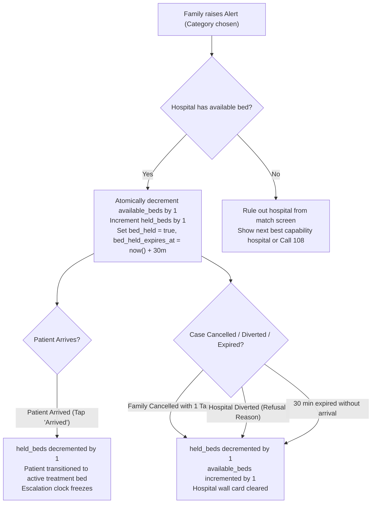

# Resource Management & Append-Only Audit Model

This document outlines how hospital beds and team capacity are allocated, held, and released, as well as the tamper-proof architecture of the append-only audit trail in **GoldenHour** (`NIRMAN 2026`).

---

## 1. Resource Model: Ephemeral Bed Holds & Capacity

### Core Philosophy (PRD Section 04 & 09)
* GoldenHour is **not** an exhaustive bed management or inpatient admission system.
* GoldenHour implements a **30-minute ephemeral bed hold** to prevent false promises to families speeding toward an emergency department.



### Resource Release Rules
1. **Arrival**: When the counter marks `status = 'arrived'`, `held_beds` decrements by 1. The bed is considered occupied in the emergency department.
2. **Cancellation**: If the family cancels or diverts to another facility, `held_beds` decrements by 1 and returns directly to `available_emergency_beds`.
3. **Diversion / Refusal**: If the hospital marks "Cannot accept" (with reason), the held bed is released back to available intake immediately.
4. **Expiry**: If 30 minutes lapse without arrival or check-in, the system releases the reservation back to available inventory.

---

## 2. Append-Only Audit Model (PRD Rule #5 & #12)

### The Law
> *"Nothing is edited, only added. Every state change is a new line in an append-only log: who, what, when, why. If anything is ever questioned, the record shows exactly what happened."*

### Database Architecture
* Table: `audit_logs`
* Primary Key: `bigserial` (strictly sequential)
* Foreign Key: `alert_id` (links to `alerts.id`)
* **Database Trigger**:
```sql
CREATE OR REPLACE FUNCTION prevent_audit_log_modification()
RETURNS TRIGGER AS $$
BEGIN
    RAISE EXCEPTION 'Audit log entries are immutable and cannot be updated or deleted. (GoldenHour Rule #5)';
    RETURN NULL;
END;
$$ LANGUAGE plpgsql;

CREATE TRIGGER trg_audit_log_immutable
BEFORE UPDATE OR DELETE ON audit_logs
FOR EACH ROW
EXECUTE FUNCTION prevent_audit_log_modification();
```

### Standard Audit Actions Logged

| Action Code | Actor Type | Trigger Point | Details Payload (JSONB) |
| :--- | :--- | :--- | :--- |
| `ALERT_CREATED` | `family` | Family taps submit | `{ "alert_code": "A3F2C1", "category": "chest_pain", "bed_held": true, "drive_min": 11 }` |
| `ALERT_ACKNOWLEDGED` | `staff` | Reception clicks card | `{ "staff_role": "reception", "elapsed_sec": 24 }` |
| `TASK_CLAIMED` | `staff` | Nurse/Doc taps Claim | `{ "task_id": "...", "role": "nurse", "staff_name": "Nurse Sneha Rout", "escalation": "normal" }` |
| `ALL_TASKS_CLAIMED` | `system` | 4th task claimed | `{ "status": "ready", "elapsed_sec": 78 }` |
| `TASK_ESCALATED_AMBER` | `system` | 90s server clock check | `{ "task_id": "...", "unclaimed_tasks": 2, "duty_lead_notified": true }` |
| `TASK_ESCALATED_RED` | `system` | 180s server clock check | `{ "task_id": "...", "unclaimed_tasks": 1, "risk_flag": "critical" }` |
| `PATIENT_ARRIVED` | `staff` | Counter taps "Arrived" | `{ "arrived_at": "...", "elapsed_total": 490 }` |
| `ALERT_CLOSED` | `staff` | Doctor signs off | `{ "doctor_id": "...", "summary": "Direct to Cath Lab. Patient stable." }` |
| `ALERT_CANCELLED` | `family` | One-tap cancel | `{ "reason": "Going to local clinic instead" }` |
| `ALERT_DIVERTED` | `staff` | Duty In-Charge refuse | `{ "reason": "equipment_unavailable", "notes": "Cath lab generator trip" }` |

### Legal & Pilot Review Value
In post-incident audits or pilot efficacy reports, the log allows exact reconstruction of:
1. When was the alert generated?
2. Did the hospital acknowledge within $\le 45$ seconds?
3. What was the exact `time_to_claim` for each preparation role?
4. Did the case escalate to Amber or Red?
5. What was the exact door-to-treatment handover time?
