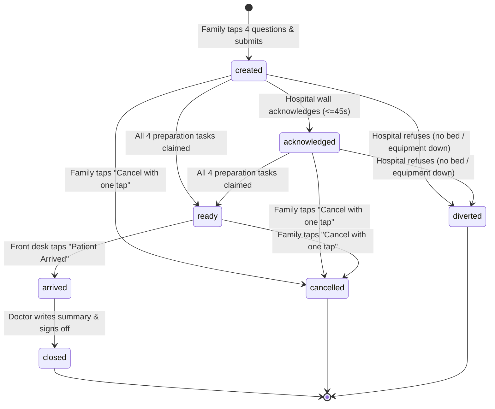
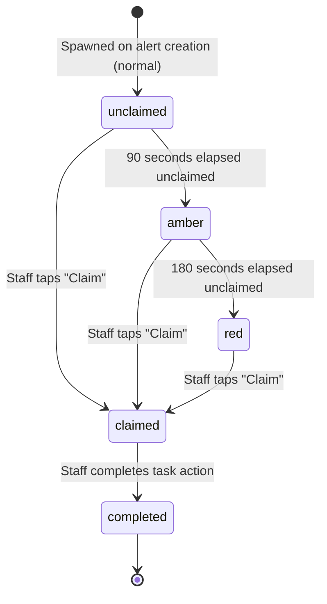

# Task Lifecycle, Ownership & Escalation Model

This document outlines the state machine, ownership rules, concurrency resolution, and server-side escalation clock for **GoldenHour** (`NIRMAN 2026`).

---

## 1. Alert & Task State Machines

### Alert State Machine



### Task State Machine



---

## 2. Permitted Transitions Matrix

| Entity | Current State | Target State | Trigger / Actor | Precondition / Check |
| :--- | :--- | :--- | :--- | :--- |
| **Alert** | `created` | `acknowledged` | Reception / Ops Wall | Within 45s of arrival on wall. |
| **Alert** | `created` / `acknowledged` | `ready` | System Trigger | All 4 tasks have status `'claimed'`. |
| **Alert** | Any active state | `arrived` | Counter / Front Desk | Patient crosses hospital gate. **Escalation clock freezes immediately.** |
| **Alert** | `arrived` | `closed` | Emergency Doctor | Arrival confirmed and clinical record closed. |
| **Alert** | Active (pre-arrival) | `cancelled` | Family (via Token) | One tap on family page. Releases held bed immediately. |
| **Alert** | Active (pre-arrival) | `diverted` | Duty In-Charge | Requires valid refusal reason (`no_bed`, `no_team`, `equipment_unavailable`, etc.). |
| **Task** | `unclaimed` | `claimed` | Staff (Doctor/Nurse/Pharm/Transport) | Atomic execution via `claim_task()`. |
| **Task** | `unclaimed` | `amber` | Server Clock (at 90s) | Elapsed time $\ge 90$s and `status = 'unclaimed'`. |
| **Task** | `amber` | `red` | Server Clock (at 180s) | Elapsed time $\ge 180$s and `status = 'unclaimed'`. |

---

## 3. Concurrency & Race Condition Resolution

### The Problem (PRD Rule #9)
> *"If two nurses tap 'claim' at the same moment, one wins and the other is told who won. Nobody is sent twice."*

In a busy ER, multiple personnel may view the same unclaimed card simultaneously. Without atomic database-level locking, two nurses could tap "Claim" concurrently, resulting in duplicate assignment or double preparation.

### The Solution: Atomic Conditional Update
Instead of client-side validation, task claiming is handled by a single PostgreSQL stored procedure: `claim_task(p_task_id UUID, p_staff_id UUID)`.

```sql
UPDATE alert_tasks
SET status = 'claimed',
    claimed_by = v_staff.id,
    claimed_by_name = v_staff.name,
    claimed_at = timezone('utc', now()),
    updated_at = timezone('utc', now())
WHERE id = p_task_id
  AND status = 'unclaimed'
RETURNING * INTO v_task;
```

* **Winner**: The first transaction to acquire the row lock successfully modifies the row, receives the updated record, and writes a `TASK_CLAIMED` entry to `audit_logs`.
* **Second Tapper**: Receives `{"success": false, "already_claimed": true, "claimed_by_name": "Nurse Sneha Rout", "claimed_at": "..."}`.
* **Ops Wall**: Broadcasts the update across Supabase Realtime in $< 2$ seconds.

---

## 4. The Server-Side Escalation Clock

### The Law (PRD Rule #2)
> *"A timer that runs in a browser tab is not a timer. Tabs close, phones sleep, screens refresh. So the deadline is calculated on the server from a stored timestamp."*

### Step-by-Step Escalation Timeline

| Elapsed Time | Escalation Level | System Action | What Hospital Wall Displays |
| :--- | :--- | :--- | :--- |
| **0:00** | **Normal** | Alert written with `created_at = now()`. 4 preparation tasks spawned. Ephemeral bed hold locked. | New card appears. Running countdown: *"4 tasks unclaimed"*. |
| **0:40** | **Normal** | Mid-window check. | Displays progress badge: e.g., *"2 of 4 claimed"*, naming open roles. |
| **1:30 (90s)** | **Amber** | Server flags unclaimed tasks as `amber`. Logs `TASK_ESCALATED_AMBER`. Duty Lead notified. | Card border turns amber with **warning triangle icon** + text: `AMBER: UNCLAIMED 1:30`. |
| **3:00 (180s)** | **Red** | Server flags unclaimed tasks as `red`. Logs `TASK_ESCALATED_RED`. Case flagged at critical risk. | Card turns solid red with **octagonal stop icon** + text: `RED: CRITICAL RISK`. Family view indicates *"Hospital still preparing"*. |
| **Arrival** | **Freeze** | Front desk searches 6-char code `A3F2C1`, taps *"Arrived"*. | **Escalation clock stops instantly.** Timer ceases. Case moves to Arrived/Closed column. |

### Color-Blind Accessibility (PRD Rule H-06)
Color is **never** the sole indicator:
* **Normal**: Green badge + circular checkmark + text *"X of 4 TAKEN"*.
* **Amber (90s)**: Amber badge + warning triangle ($\Delta$) + text *"AMBER: UNCLAIMED"*.
* **Red (180s)**: High-contrast red badge + octagonal icon ($\square$) + text *"RED: CRITICAL"*.
