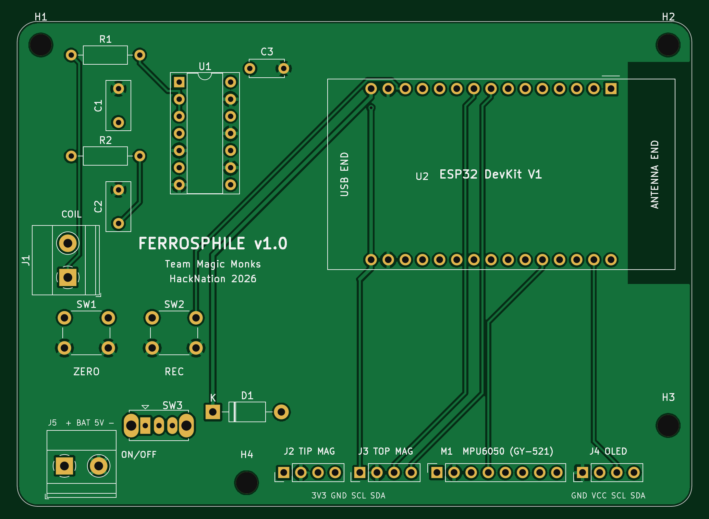

# Ferrosphile hardware: carrier PCB



A 2-layer carrier board, 100 × 72 mm, all through-hole. The ESP32 DevKit, the tilt board and the compasses plug in, so nothing on the board is hard to solder.

- Schematic: [docs/ferrosphile-schematic.pdf](docs/ferrosphile-schematic.pdf)
- PCB layout (both copper layers): [docs/ferrosphile-pcb-layout.pdf](docs/ferrosphile-pcb-layout.pdf)
- Gerbers for ordering: [fabrication/ferrosphile-gerbers.zip](fabrication/ferrosphile-gerbers.zip)
- BOM: [fabrication/ferrosphile-bom.csv](fabrication/ferrosphile-bom.csv)

Checked in KiCad 8: **ERC 0 errors, DRC 0 violations, 0 unrouted pads, PCB matches schematic.**


## Folder layout

```
hardware/
  kicad/          KiCad 8 project (open ferrosphile.kicad_pro)
    ferrosphile.kicad_sym   custom symbols: ESP32 DevKit V1, GY-521
    ferrosphile.pretty/     custom footprint: ESP32 DevKit V1 (2 x 1x15 headers)
  fabrication/    Gerbers + drill files (zip), BOM
  docs/           schematic PDF/SVG/PNG, PCB previews
```


## What is on the board

| Block | Parts | What it does |
|---|---|---|
| LC oscillator | U1 74HC04, R1 1M, R2 1k, C1/C2 100n film, J1 coil | Pierce oscillator around the search coil, about 42 kHz. Metal near the coil shifts the frequency. |
| Buffer | U1B | Squares the signal for the ESP32 pulse counter |
| Brain | U2 ESP32 DevKit V1 (30-pin) | Reads all sensors, talks to a laptop over USB |
| Gradiometer | J2 tip compass, J3 top compass (GY-271) | Two QMC5883L boards. Bottom minus top cancels Earth's field. |
| Tilt | M1 GY-521 (MPU6050) | Corrects for how the probe is held |
| Display | J4 (optional) | 0.96" SSD1306 OLED |
| Controls | SW1 ZERO, SW2 RECORD | Zero (learn "nothing here") and record buttons |
| Power | J5, SW3, D1 1N5819 | Optional 5 V battery input. USB alone also works. |


## Pin map

| Net | ESP32 pin | Connects to |
|---|---|---|
| OSC_FREQ | GPIO34 | U1 pin 4 (buffered oscillator) |
| SDA0 / SCL0 | GPIO21 / GPIO22 | J2 tip compass (0x0D), M1 MPU6050 (0x68), J4 OLED (0x3C) |
| SDA1 / SCL1 | GPIO25 / GPIO26 | J3 top compass (0x0D) |
| BTN_ZERO | GPIO14 | SW1 to GND (internal pull-up) |
| BTN_REC | GPIO13 | SW2 to GND (internal pull-up) |
| VIN | VIN | J5 battery, through SW3 and D1 |
| +3V3 | 3V3 | U1 and all sensors |

Both compasses use address 0x0D, so each one gets its own I2C bus.

Connector pin order, printed on the board:
- J2 and J3: 3V3, GND, SCL, SDA
- J4: GND, VCC, SCL, SDA (the usual OLED order)
- J5: + then −


## Order the PCB

1. Upload `fabrication/ferrosphile-gerbers.zip` to JLCPCB, PCBWay or any PCB maker.
2. Settings: 2 layers, 1.6 mm, 100 × 72 mm, 1 oz copper, HASL. Any colour.
3. Smallest track is 0.3 mm and the smallest gap is 0.25 mm, so the cheapest standard option works.

**Before you order, measure your ESP32 board.** The footprint expects the two header rows 25.4 mm apart (DOIT DevKit V1, 30-pin). Some clones are 22.86 mm. If yours differs, edit `ferrosphile.pretty/ESP32_DevKit_V1_30pin.kicad_mod`.


## Extra parts to solder (not in the BOM)

- 2 × 1x15 female headers, 2.54 mm, for the ESP32
- 1 × 1x8 female header for the GY-521 (M1 is a socket)
- 1 × DIP-14 IC socket for the 74HC04
- 4-wire cables for the two compasses, twisted 2-wire cable for the coil


## Assembly order

1. Lowest parts first: R1, R2, D1 (stripe to the "K" side), C1, C2, C3.
2. DIP-14 socket, then buttons and the slide switch.
3. Screw terminals J1 and J5, pin headers J2, J3, J4.
4. Female headers for the ESP32 and the GY-521.
5. Before plugging anything in: check with a multimeter that 3V3 and GND are **not** shorted.
6. Plug in the 74HC04 (notch to the top), the ESP32 (USB end to the left) and the GY-521.


## Wiring the probe

- **Coil (J1):** 35–40 turns of 28 SWG enamelled wire on a 10 cm ring, about 250–300 µH. Scrape the enamel at the ends. Use twisted wire to the board.
- **Tip compass (J2):** in the probe tip, next to the coil.
- **Top compass (J3):** about 30 cm higher up the pole. The bigger the gap, the better the Earth's field cancels.
- Keep steel screws and magnets away from both compasses.


## Design notes

- C1 and C2 must be film capacitors. Ceramic ones drift with heat and cause fake readings.
- GPIO34 is input-only. That is fine here, because it only reads the oscillator.
- A ground pour covers both layers, except under the ESP32 antenna (keep-out zone).
- D1 stops USB power flowing back into the battery board when both are connected.
- Power nets use 0.5 mm tracks where there is room.


## Edit in KiCad

Install KiCad 8 or newer, then open `kicad/ferrosphile.kicad_pro`. The project carries its own symbol and footprint library, so it opens without extra setup.
